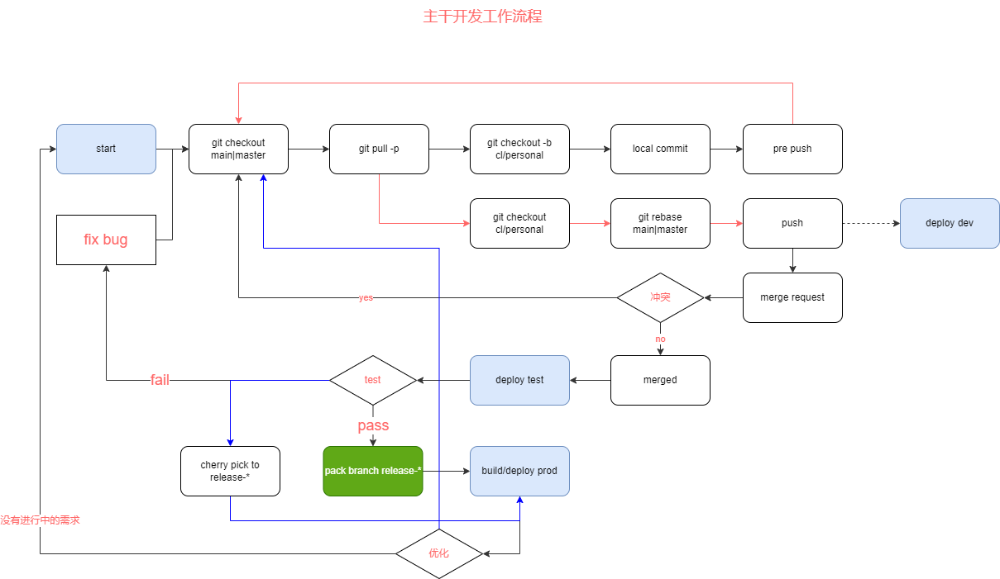

# ghcloud monorepo

TODO(anybody): neet to supplement this

# 主要文件及目录说明

[目录规范](https://alidocs.dingtalk.com/mind/edit?cid=52176704292&type=m&docKey=mPdnp8PJaGG6nw98&dentryKey=NlB10bkkUN7Xj0Xv&utm_source=im&utm_medium=im_card&dontjump=true&chInfo=im)

# Agent 开发入口

本仓库的 Agent 知识、技能路由、命令发现和文档治理以 [`.agents/`](./.agents/README.md) 为权威来源。

# git 说明

> 本仓使用 `release 分支集成` 模式（`main` 为稳定主干，变更先进 release 分支，确认后再合 main）。完整决策见 [ADR 0011](./docs/adr/0011-release-branch-and-versioning-workflow.md)。



> 主要分支命名规则

- `main`（必须）: 主干分支，需要保证永远最新稳定可用。
- `release-${模块}-${版本号（一般为日期）}`（必须）:
  集成分支。新一轮开发从 `main` 拉出，期间所有变更经 MR 合入本分支，确认要上灰度 / 正式后再合并到 `main`，完整分支名如 `release-cube-web-personal-20230405.1`。
- `$[变更人]/${变更范围描述}`（推荐）:
  正在开发中的内容，该分支存活周期不建议超过 1
  天，每次合并后需要清理该分支，完整分支名如 `person/feat_cube_web_personal` | `person/fix_ue5_migrate_xxx`

> Release 工作流公约

- **拉分支**：新轮次从最新 `main` checkout `release-*`。
- **合并模式**：feature → release、release → main 统一使用 **rebase**（release → main 为 rebase + fast-forward）。
- **并行规则**：允许多条 `release-*` 同时存在，**先到先得**——先合 `main` 者为准；**后到者必须 rebase 到最新 `main`，并重新调整版本号、重打 tag**。
- **打 tag**：release **合并到 `main` 后由 CI 立即自动**打仓库级 tag `tag-{release_branch_name}`（无需人工）。
- **版本号校验**：开发期不校验；`release-*` / `main` 分支 **push 时本地强校验**（应急可 `SKIP_VERSION_CHECK=1 git push` 跳过）；**MR 合并到 `main` 时 CI 强校验**（要求版本号 semver 严格大于基准，失败需人工修正后再提交，仅携带 skip commit 可豁免）；MR 合并到 `release-*` 仅告警。

> Hotfix 工作流公约（现场问题）

- **必须从历史 release tag** `{origin_release_tag}` checkout 出 hotfix 分支，不在主线上直接改。
- **hotfix tag**：`{origin_release_tag}-hotfix.{n}`，`{n}` = 该 release tag 被 hotfix 的第几次。
- **hotfix 包版本**：`{该包在 origin tag 时的版本}-hotfix.{m}`（base 用原号不 +1，如现场 `1.1.1` → `1.1.1-hotfix.{m}`），`{m}` 为该包独立的 hotfix 计数。
- hotfix 制品**手动推到对应部署容器**；该修复需 **cherry-pick 前向带入当前 `release-*` 与 `main`**，避免后续版本丢失修复。
- **hotfix 分支不直接合并 `main`**（直接合会造成 `main` 版本降级）。

# 环境准备

- [bun](https://bun.com/docs/installation) >= `1.3.3`
- [nodejs](https://nodejs.org/en/download) >= `v24.11.1`（可选，仅当需要时使用）

> **注意**：本项目支持纯 bun 开发环境，nodejs 为非必选项。为确保 VSCode oxc 插件可以正常运行，需要手动创建符号链接：
>
> ```bash
> ln -s $(which bunx) /usr/local/bin/node
> ```
>
> 或者根据你的 bunx 实际路径创建：
>
> ```bash
> ln -s /path/to/your/bunx /usr/local/bin/node
> ```

# 为什么使用 bun ？

[参见](https://bun.com/)

# 依赖安装

在项目根目录执行

```
# 常规安装（会严格根据 bun.lock 安装依赖）
bun ci
# 有定义的 package 包版本变更时（会探测包更新，应该在明确需要更新版本时再使用）
bun install
```


# bun workspace 模式常见问题

## 运行某个子项目的脚本

```ts
// 在某个子项目环境执行脚本（类似 npm run）
bun --cwd=path/to/pkg run dev
/**
 * 释义：
 * - `bun -F` 从当前仓库中过滤出符合要求的项目（package.json 中定义的 name）
 * 参考：[bun filter](https://bun.sh/docs/pm/filter)
 */
// 对指定项目安装依赖
bun -F @ghcloud/cube-ui i

// 对指定项目添加依赖
// 如果包名能从当前项目中匹配到，pnpm 会优先链接到当前仓库中，如果不想要链接当前仓库的包，需要指定具体的版本号，如 `@ghcloud/cube-ui@0.0.1`。
bun -F @ghcloud/cube-ui add @ghcloud/xxx

// 运行指定项目的脚本
bun -F @ghcloud/cube-ui scriptName

// 运行多个项目的同名脚本（串行）
bun -F @ghcloud/pkgA -F @ghcloud/pkgB -F @ghcloud/pkgC scriptName
//or
bun -F "@ghcloud/pkg*" scriptName
```

## 发布到仓库

```ts
// login
bunx npm login --registry http://nexus.guhecloud.com:8888/repository/npm-hosted/
// build
bun -F @ghcloud/pkgName build
// publish
bun --cwd=prod/ghcloud/pkgName publish --access public --registry http://nexus.guhecloud.com:8888/repository/npm-hosted/
```

## 依赖管理

### 添加全局共享依赖

> [参考](https://bun.sh/docs/pm/catalogs)

package.jsonc

```json
{
  "workspaces": [
    "catalog": {
      "shared-pkg": "version"
    },
    "catalogs": {
      "custom": {
        "shared-pkg-1": "version"
      }
    }
  ]
}
```

### 在子项目中使用共享的依赖

prod/submodule/package.json

```jsonc
{
    "dependencies": {
        "shared-pkg": "catalog:",
        "shared-pkg-1": "catalog:custom",
    },
}
```

### 源码依赖

prod/submodule-a/package.json

```jsonc
{
    "name": "@ghcloud/submodule-a",
    "version": "1.0.0",
}
```

prod/submodule-b/package.json

```jsonc
{
    "name": "@ghcloud/submodule-b",
    "dependencies": {
        "@ghcloud/submodule-a": "workspace:^",
    },
}
```

## package.json 配置

```json
{
    // 包/模块名，被依赖时会使用到。当前仓库命名规则 `@ghcloud/${pkgName}`
    "name": "@ghcloud/pkgName",
    // 模块版本
    "version": "0.0.1",
    // 作者
    "author": "ghcloud",
    // 主入口，当被单仓中其他模块直接依赖时，会使用此入口，建议直接依赖到源码
    "main": "src/main.ts",
    "publishConfig": {
        // 发布仓库设置，ghcloud 私有仓固定该配置
        // TODO: bun 当前版本对该配置不支持，但仍需配置。后续可能会支持 [issue](https://github.com/oven-sh/bun/issues/15599)
        "registry": "http://nexus.guhecloud.com:8888/repository/npm-hosted/"
    },
    // 发布时携带的文件
    "files": ["lib/"]
}
```

## 尚未解决的问题

- `bun worksapce` 中存在未指定 `name` 的 `package.json` 时，会导致整仓 `install`
  失败，临时解决方案是将该文件的输出改到 `node_modules/.tmpout/dist`

    > 参见1：`prod/customize/operating-room/data-viz-offline-config-generator`

    > 参见2: `prod/customize/operating-room/mqtt-broadcast`

    > [bun-issue](https://github.com/oven-sh/bun/issues/5282)
