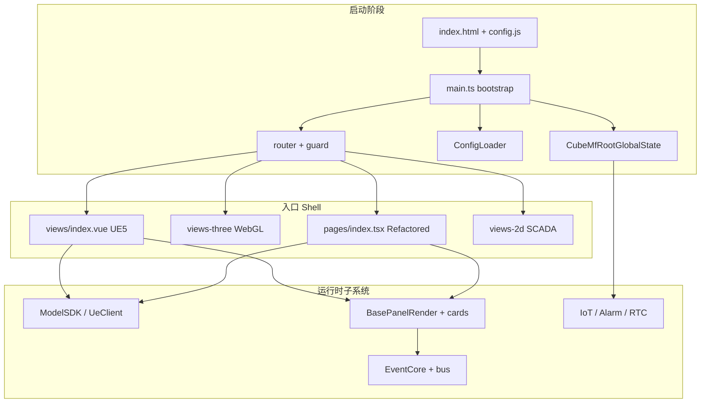
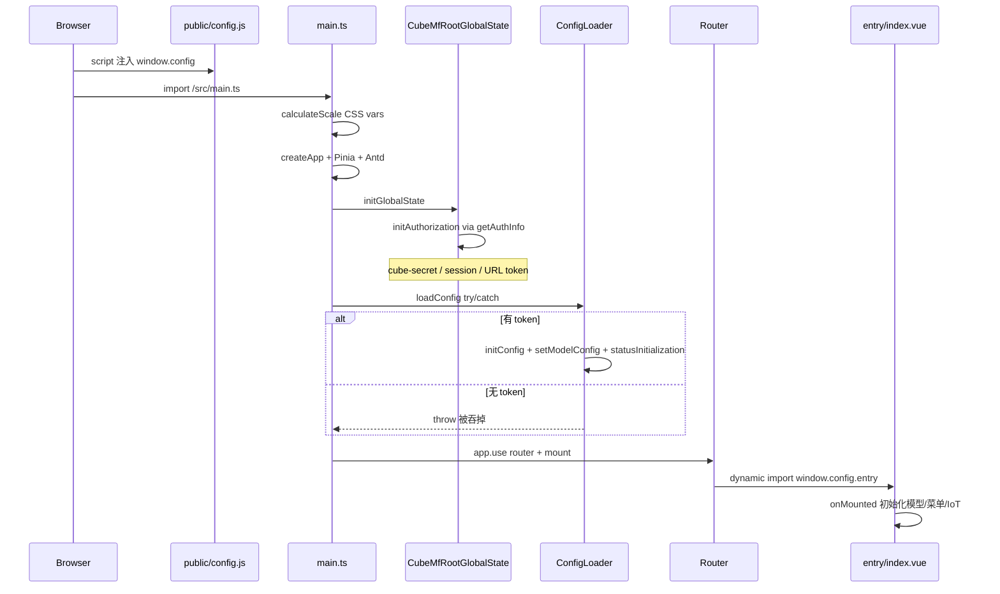
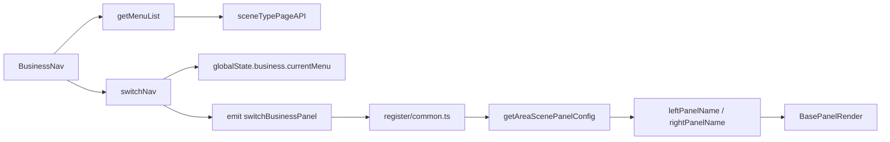

# 01 — 运转逻辑

本文描述 `@ghcloud-legacy/ue5-migrate` 从浏览器加载到业务交互的完整运行时逻辑。

---

## 1. 总览



---

## 2. 启动链路

### 2.1 时序（从 HTML 到首屏）



### 2.2 关键步骤说明

| 步骤 | 文件 | 行为 |
|---|---|---|
| 静态配置 | [`index.html`](../index.html) L10 | 加载 `/config.js`，再加载 `main.ts` |
| 运行时配置 | [`public/config.js`](../public/config.js) | 写入 `window.config`（tenantConfig、websocket、feature） |
| 大屏适配 | [`src/main.ts`](../src/main.ts) L23–56 | 按分辨率设置 `--scale`、`--font-size-scale` |
| Vue 装配 | [`src/main.ts`](../src/main.ts) L57–64 | Pinia、`createGlobalStateForVue`、directives、Antd |
| 全局集成 | [`src/globalState.ts`](../src/globalState.ts) | mf-root、RTC、告警弹窗回调注册 |
| 配置加载 | [`src/main.ts`](../src/main.ts) L67–70 | `ConfigLoader.loadConfig()`，**失败静默** |
| 路由挂载 | [`src/main.ts`](../src/main.ts) L71–72 | `app.use(router)` → `#app` |
| 根组件 | [`src/App.vue`](../src/App.vue) | `a-config-provider` + `<router-view>` + theme |

**重要行为**：首次启动时若用户未登录，`ConfigLoader` 在 `main.ts` 中会失败并被 `catch` 吞掉；**完整配置加载发生在登录选租户之后**（见 §3.2）。

---

## 3. 鉴权与子系统激活

### 3.1 鉴权来源（四条路径）

`@ghcloud/cube-auth-utils` 的 `getAuthInfo()` 在 mf-root `initAuthorization` 中被调用，按优先级合并以下来源：

| 路径 | 机制 | 典型场景 |
|---|---|---|
| URL `cube-secret` | `CubeAuthService.getTokenBySecret()` → sessionStorage | bimops 新窗口打开 |
| URL `access_token` | 写入 `GH-Token` session | 外链带 token |
| sessionStorage | `GH-Token` + `GH-NowEnterprise` | 同域刷新 |
| OAuth 登录页 | 账号密码 + 验证码 → 选租户 | 独立访问无 SSO |

终端类型固定为 `CubeTerminalEnum.VISUALIZATION`（`three-dimensional-visualization`）。

### 3.2 登录页完整流程

文件：[`src/login/index.vue`](../src/login/index.vue)

```
mounted → sessionStorage.clear() → 加载验证码
  ↓
handleFinish → OAuth 登录 → setAuthInfo({ token })
  ↓
getTenantList → 用户点击租户 clickTenant
  ↓
setAuthInfo({ tenant, token })
sessionStorage.setItem('three-visualizations', 'true')
await initGlobalState()      ← 消息 socket、告警弹窗、RTC 在此激活
await ConfigLoader.loadConfig() ← 权威配置加载
router.push({ name: 'home' })
```

### 3.3 路由守卫

文件：[`src/router/index.ts`](../src/router/index.ts)

```typescript
router.beforeEach(async (to, from, next) => {
  if (to.name === "login") {
    sessionStorage.clear();
    next();
    return;
  }
  const authInfo = CubeMfRootGlobalState.getInstance().mfRootState.authInfo;
  if (authInfo?.token) {
    authStore.token = authInfo.token;
    authStore.tenant = authInfo.tenant;
    initCubePlayerAuth(authStore);
    loadPlayerSDK();
    next();
  } else {
    sessionStorage.clear();
    next({ path: "/login" });
  }
});
```

守卫读取 **mf-root 全局 auth**，同步到 legacy `authStore` 并初始化视频播放器 SDK。

### 3.4 出站 cube-secret（跳转业务平台）

| 文件 | 用途 |
|---|---|
| [`src/api/auth-store.ts`](../src/api/auth-store.ts) | `hrefToCubeBusiness()` → `getSecretByToken()` → 带 `cube-secret` 跳转 |
| [`pages/widget/title-bar/components/to-business/to-business.tsx`](../src/pages/widget/title-bar/components/to-business/to-business.tsx) | 标题栏「返回业务」按钮，`window.open` + cube-secret |

### 3.5 子系统激活时机

| 子系统 | 激活条件 | 初始化位置 |
|---|---|---|
| mf-root auth | `initGlobalState()` | main.ts 或 login 后 |
| 消息 WebSocket | mf-root `initMessageSocket()` | 需有效 token |
| 全局告警弹窗 | `CubeAlarmModal` via message socket | 同上 |
| RTC 通话 | `initCommunication()` + `CallManager` | 需注册 `onRtcCallReceived` |
| ConfigLoader | 有效 token | login 后或 main 尝试 |
| IoT WebSocket | 入口页 `onMounted` | `useIotSocket()` |
| 视频播放器 | 路由守卫通过 | `loadPlayerSDK()` |

---

## 4. ConfigLoader 与 window.config

文件：[`src/pages/config-loader.ts`](../src/pages/config-loader.ts)

### 4.1 三阶段流程

```
ConfigLoader.loadConfig()
  │
  ├─ initConfig()
  │    ├─ 要求 CubeMfRootGlobalState.authInfo.token（否则 throw）
  │    ├─ initAuthStore (cube-safety-supervision-app)
  │    ├─ 同步 auth → useStateStore.authInfo
  │    └─ 按 tenant 过滤 window.config（perspective、connectLines、systemName、entry）
  │
  ├─ setModelConfig()
  │    ├─ projectId ← URL ?projectId= 或 CubeVisualizationService.getVisualProjectList()
  │    ├─ getModelConfig(projectId) → JSON.parse(modelConfiguration)
  │    ├─ 合并：entry、systemName、modelPath、scada、configuration2D、视角、漫游、标签...
  │    └─ entry ∈ ['views-three','views-3d'] → handleWebGlConfig()
  │
  ├─ this.config = window.config
  └─ statusInitialization() → useStateStore.initState()
```

### 4.2 entry 解析优先级

1. 默认：`views`
2. `public/config.js` → `tenantConfig[].entry`（按 tenant ID）
3. 后端 `modelConfiguration.entry`（**覆盖**静态配置）

### 4.3 renderType 推导

文件：[`src/pages/state/use-state-store.ts`](../src/pages/state/use-state-store.ts)

根据 `ConfigLoader.config.entry` 映射：

| entry | renderType |
|---|---|
| `views`、`views-old-area` | `UE5` |
| `views-three`、`views-3d` | `WEBGL` |
| `views-gis` | `GIS` |
| `views-2d`、`views-2d-old-area` | `2D` |

类型定义：[`src/typings/global.d.ts`](../src/typings/global.d.ts) L38–166。

---

## 5. 多入口 Shell 与模型初始化

### 5.1 路由动态加载

```typescript
// src/router/index.ts L14-17
component: async () => import(`@/${window.config.entry ?? 'views'}/index.vue`)
```

注释掉但未启用的 Refactored 默认路由：

```typescript
// component: async () => (await import('@/pages/index')).ViewPage
```

### 5.2 各入口初始化差异

| entry | Shell 文件 | 模型初始化方式 | 行数 |
|---|---|---|---|
| `views` | `views/index.vue` | `TopHeader.loadUE5Model()` → 直调 `UeClient.loadUE5` | 1642 |
| `views-three` | `views-three/index.vue` | `threeInstance.initModel()` 直调 Three.js | 1181 |
| `views-3d` | `views-3d/index.vue` → `pages/index.tsx` | `modelSDK.initModal()` | 薄包装 |
| `views-gis` | `views-gis/index.vue` → `pages/index.tsx` | `modelSDK` → `WebGisSDK` | 薄包装 |
| `views-2d` | `views-2d/index.vue` | 无 3D；背景图 + iframe SCADA | 588 |
| `views-shengNong` | **本仓库不存在** | 见 `legacy/ue5-sn-migrate` | — |

### 5.3 双轨模型初始化（核心债务）

**Legacy UE5 路径**（生产默认 `entry=views`）：

```
views/index.vue onMounted
  → topHeader.loadUE5Model(dom)
  → components/basic/header/header.vue
  → UeClient.getInstance().loadUE5(dom, modelPath)
```

**Refactored 路径**（`entry=views-3d` / `views-gis`）：

```typescript
// pages/index.tsx L45-52
await modelSDK.initModal(modelContainer.value)
await modelSDK.waitModalLoad()
eventInstance.emitEvent('createBuildIcon')
```

两套路径共用 `@ghcloud/cube-visual-sdk` 的 `UeClient`，但 **接线方式不同**；Legacy Shell 仍部分 import `modelSDK` 做相机/漫游操作。

---

## 6. ModelSDK

### 6.1 策略模式

文件：[`src/pages/model-sdk/sdk.ts`](../src/pages/model-sdk/sdk.ts)

```typescript
if (renderType === 'UE5')      this.parent = new UE5SDK()
else if (renderType === 'GIS') this.parent = new WebGisSDK()
else                           this.parent = new WebGlSDK()
```

| SDK | 文件 | 底层 |
|---|---|---|
| UE5SDK | `ue-sdk.ts` | `UeClient` WebRTC 像素流 |
| WebGlSDK | `web-gl-sdk.ts` | `cubeWeb3DInstance` Three.js |
| WebGisSDK | `web-gis.ts` | `CubeMapLeaflet` |

UE 客户端 UA 检测：`navigator.userAgent.includes('UnrealEngine')` 时使用 `ws://localhost:8080`。

### 6.2 3D 事件

| 事件注册 | 文件 | 职责 |
|---|---|---|
| common | `pages/event/register/common.ts` | 菜单切换面板、区域切换、设备定位、楼栋标签 |
| model-click | `pages/event/register/model-click.ts` | 模型/icon 点击 |
| gis | `pages/event/register/gis.ts` | GIS 专属交互 |

事件名定义：[`pages/event/event-name.ts`](../src/pages/event/event-name.ts)（22 个事件）。

Legacy Shell 在 `views/index.vue` 中 **重复注册** 部分 EventCore handler（如 `changeModelGlobalCameraView`、`switchBusinessPanel`），与 `register/common.ts` 形成桥接。

---

## 7. 菜单 → 面板 → 卡片

### 7.1 业务菜单切换



关键文件：

- [`pages/widget/business-nav/business-nav.tsx`](../src/pages/widget/business-nav/business-nav.tsx)
- [`pages/event/register/common.ts`](../src/pages/event/register/common.ts) L348–378

Legacy Shell（`views/index.vue` L603–640）内联实现相同 API 调用，不经过 EventCore。

### 7.2 BasePanelRender 决策树

文件：[`components/businessPanel/base-panel-render/base-panel-render.tsx`](../src/components/businessPanel/base-panel-render/base-panel-render.tsx)

```
panelName 传入
  │
  ├─ panelName ∉ panelDefinition（cube-visual-sdk）
  │    └─ Legacy 整板：BusinessPanel[panelName] 或 AlarmPanel[panelName]
  │
  └─ panelName ∈ panelDefinition
       ├─ universalPanelVo.items 有自定义 JSON → 解析 customCards
       └─ 否则 → panelDefinition[panelName].cards
            └─ 逐 card.code 从 CardCollective 取组件渲染
```

### 7.3 card-register

文件：[`card-register.ts`](../src/components/businessPanel/base-panel-render/card-register.ts)（1282 行）

- ~354 个 `defineAsyncComponent` 懒加载条目
- 8 个域级 bundle spread（`pz_demo_cards`、`command_dispatch_cards` 等）
- key 必须与 `cube-visual-sdk` 的 `cardDefinition` code 一致

### 7.4 面板刷新机制

`base-panel-render.tsx` L73–78：每小时 `panelKey++`（注：`panelKey` 当前未绑定到渲染 key，实际 remount 效果有限，见优化文档 §17）。

面板显隐由 `globalState.menuVisible`、`globalState.panel.visible`、`panelName` 三者共同控制 CSS offset。

---

## 8. 实时子系统

### 8.1 IoT WebSocket

文件：[`src/utils/iotSocket.ts`](../src/utils/iotSocket.ts)

```
onMounted → new GHIotSocket({ token, tenant, terminal: VISUALIZATION })
onmessage:
  WELCOME → noop
  SUBSCRIBE_PUSH → piniaUseSubscribeStore.subscribeData
```

调用点：`pages/index.tsx`、`views/index.vue`、`views-2d/index.vue`。

Token 来源：`CubeMfRootGlobalState.mfRootState.authInfo`（setup 时读取一次）。

### 8.2 告警

```
initGlobalState()
  → onAlarmModalReady → CubeAlarmModal 注册
  → onClickDetail → openAlarmDetailModal (pages/widget/modal/)
  → onDeviceLocate → eventInstance.emitEvent('openDeviceFloor')
  → onAlarmNotice → refreshAlarmBadge
```

2D 入口另有本地 [`views-2d/alarm-modal.vue`](../src/views-2d/alarm-modal.vue)。

### 8.3 RTC 音视频

文件：[`src/globalState.ts`](../src/globalState.ts) L33–51

```
onRtcCallReceived → createCallNotifyForWebApp [@ghcloud/desktop-client-ui]
                  → onPickup → createCallInterface → CallManager.accept()
onRtcCallEnd → unMountCallNotify + unMountCallInterface
```

---

## 9. 双轨状态与事件

### 9.1 两套 Pinia Store

| 轨道 | 路径 | 用途 |
|---|---|---|
| Refactored | `pages/state/use-state-store.ts` + head/menu/area/other | 面板、菜单、业务、authInfo、renderType |
| Legacy | `piniaStore/menu.ts`、`area.ts`、`other.ts`、`iotSocketStore.ts` 等 7 文件 | 区域导航、设备选择、IoT 实例、漫游 |

Legacy Shell（`views/index.vue`）**同时使用两套**：面板名走 `useStateStore.globalState.panel`，区域/楼栋走 `piniaStoreMenu` / `piniaStoreMarket`。

### 9.2 两套事件总线

| 总线 | 文件 | 特点 |
|---|---|---|
| EventCore | `pages/event/event-core.ts` | 强类型、须注册、未注册 throw |
| legacy bus | `utils/bus.ts` |  plain mitt，设备面板/相机切换 |

---

## 10. 外部包集成一览

| 包 | 集成点 | 用途 |
|---|---|---|
| `@ghcloud/cube-mf-root` | main、globalState、router、request 拦截器 | 全局 auth、消息、告警、RTC |
| `@ghcloud/cube-auth-utils` | mf-root initAuthorization | getAuthInfo、cube-secret |
| `@ghcloud/cube-visualization-service` | config-loader | 可视化项目列表/配置 |
| `@ghcloud/cube-visual-sdk` | model-sdk、panelDefinition、UeClient | 3D 引擎 + 卡片 schema |
| `@ghcloud/cube-map-plugins` | web-gis.ts | GIS Leaflet |
| `@ghcloud/cube-iot-socket` | iotSocket.ts | IoT 实时推送 |
| `@ghcloud/cube-alarm-modal` | mf-root message socket | 全局告警弹窗 |
| `@ghcloud/cube-rtc` + `desktop-client-ui` | globalState、communication.ts | VoIP |
| `@ghcloud/cube-player` | router guard | 视频播放 |
| `@ghcloud/cube-ai-assistant-*` | title-bar chat-assistant | AI 语音命令 → EventCore |

---

## 11. 常见运行时陷阱

1. **ConfigLoader 静默失败**：无 token 时 main.ts 启动不报错，但 `window.config` 不完整，直到登录后才加载。
2. **entry 时序**：router 动态 import 依赖 `window.config.entry`，须在首次导航前由 config.js 或 ConfigLoader 设置。
3. **双轨 UE5 初始化**：Legacy header 与 Refactored modelSDK 行为可能不一致。
4. **views-shengNong 缺失**：config.js 配置了该 entry，但本仓库无对应目录，运行时会 import 失败。
5. **MemoryHistory 路由**：使用 `createMemoryHistory`，浏览器 URL 不反映应用内路由状态。
6. **hourly panelKey**：BasePanelRender 定时器存在但 `panelKey` 未用于强制 remount，行为需核实。
