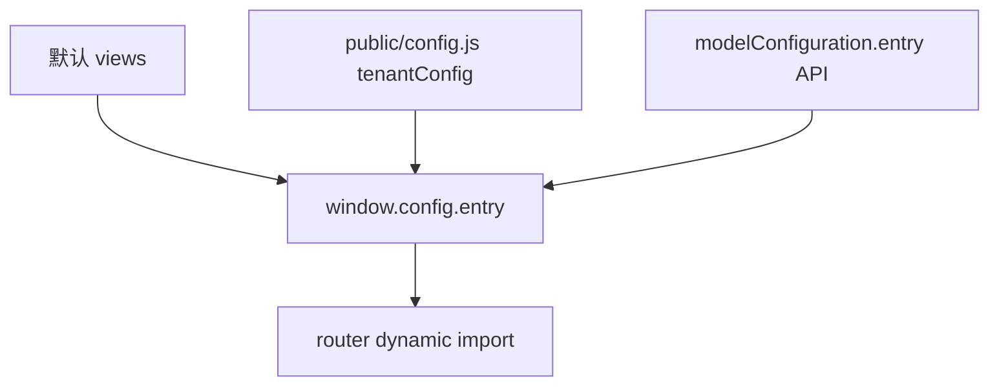

# 02 — 项目结构

本文描述 `@ghcloud-legacy/ue5-migrate` 的目录组织、模块职责、构建部署与结构性债务。

---

## 1. 包概览

| 项 | 值 |
|---|---|
| 包名 | `@ghcloud-legacy/ue5-migrate` v1.14.0 |
| 类型 | 独立 SPA（非 qiankun 子应用） |
| 部署路径 | `/apps-legacy/ue5` |
| 终端 | `three-dimensional-visualization` |
| 发布 | Nexus registry，`files: ["dist/"]` |
| 构建内存 | `--max-old-space-size=8192`（8 GB） |

---

## 2. 顶层目录树

```text
legacy/ue5-migrate/
├── index.html                     # 加载 config.js + main.ts
├── package.json
├── vite.config.ts                 # Vite 构建/dev/proxy
├── tsconfig.json                  # strict: false
├── .env / .env.dev / .env.test / .env.prod / .env.cnp / .env.pz / .env.demo
│
├── public/
│   ├── config.js                  # 运行时 window.config（index.html 引用）
│   ├── three-setting.js           # 备用配置，代码中无引用（死文件）
│   ├── map/ textures/ vite.svg
│   └── ...
│
├── dist/                          # 构建产物（npm publish）
│
└── src/                           # ~1913 文件
    ├── main.ts                    # 启动入口
    ├── App.vue                    # 根组件
    ├── globalState.ts             # mf-root / RTC / 告警
    ├── router/index.ts            # 动态 entry 路由
    ├── login/index.vue            # 登录页（392 行）
    │
    ├── views/                     # Legacy UE5 Shell（13 文件）
    ├── views-2d/                  # 2D SCADA（11 文件）
    ├── views-three/               # Legacy WebGL Shell（18 文件）
    ├── views-3d/                  # Refactored 薄包装（15 文件）
    ├── views-gis/                 # GIS 薄包装（1 文件）
    │   └── （无 views-shengNong/）
    │
    ├── pages/                     # Refactored 架构（120 文件）
    │   ├── index.tsx              # ViewPage 主壳
    │   ├── config-loader.ts
    │   ├── model-sdk/             # UE5 / WebGL / GIS SDK
    │   ├── state/                 # Pinia useStateStore 拆分
    │   ├── event/                 # EventCore + register
    │   ├── widget/                # title-bar、nav、modals（98 文件）
    │   └── utils/                 # communication 等
    │
    ├── components/                # ~1379 文件
    │   ├── businessPanel/         # 104 域 / 1275 文件
    │   ├── basic/header/          # Legacy 顶栏
    │   ├── equipmentdetails/      # 设备详情
    │   ├── equipmentPanel/        # 设备面板
    │   ├── alarmPanel/ alarmdetails/
    │   └── index.ts               # 全局组件注册（599 行）
    │
    ├── api/                       # 59 文件（axios 直调 + models/）
    ├── service/                   # request.ts, requestSn.ts, config.ts
    ├── utils/                     # bus, iotSocket, common, requestData/
    ├── piniaStore/                # 7 个 legacy store
    ├── hooks/                     # 3 个 composable
    ├── directives/                # waves
    ├── mock/                      # 14 模块（vite mock 已禁用）
    ├── style/ assets/ typings/
    └── vite-env.d.ts
```

---

## 3. 文件类型统计

| 扩展名 | 数量 | 说明 |
|---|---:|---|
| `.vue` | 968 | 主导 UI 格式 |
| `.tsx` | 421 | 集中在 `pages/widget/` 重构层 |
| `.ts` | 236 | API、store、SDK、mock |
| `.less` | 188 | 样式 |
| **src/ 合计** | **~1913** | |

**businessPanel**：104 个顶级域目录，1275 个 vue/tsx/ts 文件。

域规模 Top 5：`pz-demo`(317)、`public`(101)、`zhongda-heshun`(72)、`meat-trading`(46)、`demo-panel`(37)。

---

## 4. 模块职责表

| 路径 | 文件量 | 职责 |
|---|---:|---|
| `src/views/` | 13 | Legacy UE5 单体 Shell：player、面板、漫游、TopHeader |
| `src/views-2d/` | 11 | 2D SCADA：背景图、iframe 组态、header |
| `src/views-three/` | 18 | Legacy WebGL 单体 Shell（与 views-3d 功能重叠） |
| `src/views-3d/` | 15 | WebGL 薄包装 → `pages/ViewPage` |
| `src/views-gis/` | 1 | GIS 薄包装 → `pages/ViewPage` |
| `src/pages/` | 120 | Refactored：Layout、TitleBar、ModelSDK、state、event、modals |
| `src/components/businessPanel/` | 1275 | 104 域业务卡片 + base-panel-render + card-register |
| `src/components/basic/` | 7 | Legacy 顶栏、chat-assistant |
| `src/components/equipment*` | 67 | 设备详情/面板弹窗 |
| `src/components/index.ts` | 1 | 全局 async 组件注册表 |
| `src/api/` | 59 | REST 封装 + `models/` DTO + `shennong/` |
| `src/service/` | 3 | axios 实例（通用 + 深农） |
| `src/utils/` | 11 | 事件 bus、IoT、加解密、domain helpers |
| `src/piniaStore/` | 7 | Legacy 菜单/区域/IoT/漫游状态 |
| `src/router/` | 1 | MemoryHistory + 动态 entry + auth guard |
| `src/login/` | 1 | OAuth 登录 + 租户选择 |
| `src/globalState.ts` | 1 | mf-root 初始化、RTC、告警回调 |
| `src/mock/` | 14 | 开发 mock（`fire-control.ts` 4959 行） |
| `public/config.js` | 1 | 运行时租户路由、websocket、feature |

---

## 5. 入口路由机制

### 5.1 动态 entry

[`src/router/index.ts`](../src/router/index.ts)：

```typescript
component: async () => import(`@/${window.config.entry ?? 'views'}/index.vue`)
```

Refactored 默认路由被注释：

```typescript
// component: async () => (await import('@/pages/index')).ViewPage
```

### 5.2 entry 来源与优先级



| entry | 租户示例（config.js） | Shell 类型 |
|---|---|---|
| `views` | 默认 | Legacy UE5 monolith |
| `views-2d` | tenant 60074083（福州广汇） | Legacy 2D SCADA |
| `views-shengNong` | 21481321, 24894805, 62220897 | **不在本仓库** |
| `views-three` | 后端 modelConfiguration | Legacy WebGL monolith |
| `views-3d` | 后端 modelConfiguration | Refactored wrapper |
| `views-gis` | 后端 modelConfiguration | Refactored wrapper |

### 5.3 死入口别名

代码中引用但 **无对应目录**：

- `views-old-area`
- `views-2d-old-area`

---

## 6. 双架构对照

```text
                    ┌─────────────────────────────────────┐
                    │  共享基础设施（pages/ 部分）           │
                    │  config-loader, model-sdk, event,   │
                    │  state, widget, BasePanelRender,      │
                    │  card-register, cube-visual-sdk     │
                    └──────────────┬──────────────────────┘
                                   │
         ┌─────────────────────────┼─────────────────────────┐
         │                         │                         │
  LEGACY TRACK              HYBRID                    REFACTORED TRACK
  views/index.vue           views-three/index.vue       pages/index.tsx
  views-2d/index.vue        (WebGL 直调 three)          ↑ views-3d, views-gis
         │                         │                         │
  UeClient 直调             threeInstance               modelSDK 门面
  piniaStore/*              piniaStore/*                useStateStore
  1642 行单体               1181 行单体                  98 行 + widget 组合
```

---

## 7. 构建与部署

### 7.1 Vite 配置要点

文件：[`vite.config.ts`](../vite.config.ts)

| 项 | 配置 |
|---|---|
| 插件 | vue、vueJsx、ignoreResourcePaths、html、mock(禁用)、compression |
| CSS | Less + Ant Design 主题 vars；postcss-pxtorem rootValue=192 |
| alias | `@` → `src/` |
| external | `/resource/v1/*` 运行时加载 |
| dev server | `0.0.0.0:8098`，proxy `/api`、`/gw-bff`、`/minio`、cube 微应用路径 |
| build output | `assets/[hash].js`（无语义 chunk 名） |
| chunkSizeWarningLimit | 2000 KB |

### 7.2 环境与脚本

| 模式 | script | PUBLIC_PATH | 说明 |
|---|---|---|---|
| dev | `dev` | `/apps-legacy/ue5` | 本地 HMR |
| test | `test` / `build:test` | `/apps-legacy/ue5` | 成农批等 |
| prod | `prod` / `build:prod` | `/apps-legacy/ue5` | 生产 |
| cnp | `build:cnp` | `/apps-legacy/ue5` | 成都海吉星 |
| pz | `build:pz` | `/apps-legacy/ue5-pz-demo` | 平湖 demo |

环境变量：`VITE_BASE_API`、`VITE_WEB_SOCKET`、`PUBLIC_PATH`、`VITE_SN_V1_URL`。

### 7.3 运行时依赖

部署时必须同时提供：

1. Vite 构建产物（`dist/`）
2. [`public/config.js`](../public/config.js)（或通过 nginx 注入）
3. `/resource/v1/` 静态资源服务（模型、纹理等）

---

## 8. 依赖分层

### 8.1 workspace 包（~40 个 `@ghcloud/cube-*`）

| 类别 | 代表包 |
|---|---|
| 鉴权/平台 | cube-mf-root, cube-auth-service, cube-auth-utils, cube-protocol |
| 可视化 | cube-visual-sdk, cube-visualization-service, cube-map-plugins, cube-player |
| 实时 | cube-iot-socket, cube-message-sdk, cube-alarm-modal, cube-rtc |
| UI/主题 | cube-app-design, cube-theme, cube-ai-assistant-*, cube-speech-assistant, desktop-client-ui |
| 业务 service | cube-alarm-center, cube-iot-center, cube-mdata, cube-ouaa, cube-parking-lot, cube-visitor-management, ... |

### 8.2 3D / 地图 / 图表

| 包 | 用途 |
|---|---|
| three 0.155.0 + three.interactive + postprocessing | WebGL 渲染 |
| leaflet + d3-geo + delaunator | GIS |
| echarts + echarts-gl + echarts-liquidfill | 卡片图表 |
| gsap, lottie-web, heatmap.js | 动画/热力图 |

### 8.3 与 Cube 规范的偏差

| 现状 | Cube 规范（ADR） |
|---|---|
| axios 直调 `src/api/*` | authRequest + services-client |
| 无 `authRequest` 引用 | ADR-0004 |
| moment + dayjs 并存 | 统一 dayjs（ADR-0006） |
| `"strict": false` | strict: true |
| 无 `@ghcloud/generic-component` | 本包未使用（无需清理） |

---

## 9. 与 ue5-sn-migrate 的边界

| 维度 | ue5-migrate | ue5-sn-migrate |
|---|---|---|
| 包名 | `@ghcloud-legacy/ue5-migrate` v1.14.0 | `@ghcloud-legacy/ue5-sn-migrate` v1.6.26 |
| 主 entry | 多租户 dynamic | 硬编码 `views-shengNong` |
| `views-shengNong/` | **缺失** | 存在（globe-map、china-map 等） |
| SN 面板 | 残留 API（`api/shennong/`） | `shengnongPanel/`(60)、`shengnong-custom-panel/`(107) |
| 代码重叠 | — | ~766 相同相对路径（~42%） |
| 部署 | `/apps-legacy/ue5` | 独立包/路径 |
| 静态资源 | 隐式 `/resource/v1/ue5/` | 显式 `/resource/v1/ue5-sn-migrate/` |

**关键风险**：`public/config.js` 中 `views-shengNong` 租户若指向 ue5-migrate 部署，动态 import 将 **运行时失败**；须路由至 ue5-sn-migrate 独立部署。

---

## 10. 结构性债务清单

### 10.1 双架构并存

- Legacy monolith（`views/`、`views-2d/`、`views-three/`）与 Refactored（`pages/`）长期并行
- Router 默认仍走 Legacy；Refactored 仅 `views-3d`/`views-gis` 可达

### 10.2 重复 Shell

| 对比 | 说明 |
|---|---|
| `views-3d` vs `views-three` | 同为 WEBGL，一套用 Refactored wrapper，一套用 Legacy monolith |
| 四套 header | `components/basic/header/`、`views-2d/components/header/`、`views-three/components/header/`、`pages/widget/title-bar/` |
| 两套 chat-assistant | `basic/header/chat-assistant/` 与 `pages/widget/title-bar/components/chat-assistant/` |

### 10.3 巨型文件

| 文件 | 行数 | 角色 |
|---|---:|---|
| `views/index.vue` | 1642 | Legacy UE5 Shell |
| `card-register.ts` | 1282 | 全部卡片懒加载注册 |
| `views-three/index.vue` | 1181 | Legacy WebGL Shell |
| `components/index.ts` | 599 | 全局组件 barrel |
| `views/index.ts` | 619 | UE5 模型/标签工具函数 |
| `views-2d/index.vue` | 588 | 2D SCADA Shell |
| `mock/fire-control.ts` | 4959 | Mock 数据 |

### 10.4 businessPanel 命名/version 混乱

并行版本域：

- `command-dispatch` / `command-dispatch-v2` / `command-dispatchNew`
- `fire-control` / `fire-controlNew`
- `electronicPatrol` / `electronicPatrol-new`
- `medical-gas` / `medical-gas-new`

大型 demo 域：`pz-demo`(317 文件)、`demo-panel`、`demo-panel-layout`。

### 10.5 死配置

- `public/three-setting.js`：22 KB，**零代码引用**
- `views-old-area`、`views-2d-old-area`：runtime 逻辑引用但无目录

### 10.6 构建/类型

- 8 GB heap 构建需求
- hash-only 输出文件名，调试困难
- `strict: false`，~30 处 `@ts-ignore`

---

## 11. 入口 → Shell → 架构速查

```text
tenantConfig.entry / modelConfiguration.entry
        │
        ▼
router: import(`@/${entry}/index.vue`)
        │
        ├── views ──────────────► Legacy UE5 monolith (1642 行)
        ├── views-2d ───────────► Legacy 2D SCADA (588 行)
        ├── views-three ────────► Legacy WebGL monolith (1181 行)
        ├── views-3d ───────────► pages/ViewPage (Refactored)
        ├── views-gis ──────────► pages/ViewPage (Refactored)
        └── views-shengNong ────► ue5-sn-migrate ONLY（本仓库缺失）
```

---

## 12. 卡片开发结构（Quick Ref）

新增可视化卡片的标准路径（详见根 [`README.md`](../README.md)）：

1. `components/businessPanel/<domain>/` 创建卡片
2. `base-panel-render/card-register.ts` 注册（key = cardDefinition code）
3. `prod/cube/basic/cube-visual-sdk/.../card-definition.ts` 定义枚举
4. `prod/cube/basic/cube-visual-sdk/.../panel-definition.ts` 组合面板
