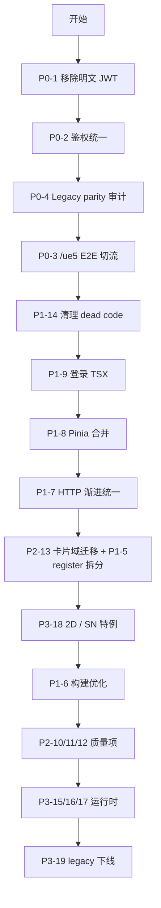

# 03 — 可优化方案与优化点

本文按 **P0–P3** 优先级列出 `@ghcloud-legacy/ue5-migrate` 的可优化项，并映射到 [`prod/cube/apps/ue5`](../../../prod/cube/apps/ue5) 迁移 Phase。

**原则**：优先在 [`apps/ue5/app`](../../../prod/cube/apps/ue5/app) 实施优化；legacy 包只读维护至 `/ue5` 切流完成。

---

## 优先级总览

| 级别 | 主题 | 项数 | 目标 |
|---|---|---:|---|
| **P0** | 安全与可上线 | 4 | 消除安全风险、完成切流 E2E、Legacy parity 审计 |
| **P1** | 工程与构建 | 5 | 拆分巨型模块、统一 HTTP/鉴权、降低构建成本 |
| **P2** | 代码质量 | 5 | 类型安全、巨型文件分解、卡片域迁移 |
| **P3** | 运行时与长尾 | 5 | WebSocket 生命周期、渲染性能、legacy 下线 |

---

## P0 — 安全与可上线

### P0-1 移除 `public/config.js` 明文 JWT

| 项 | 内容 |
|---|---|
| **问题** | `outsideTenants` 等字段含明文 JWT / 租户密钥，随静态资源下发 |
| **影响** | 任意访问者可读取 token；合规与审计风险 |
| **关键文件** | [`public/config.js`](../public/config.js) L33 附近 `outsideTenants` |
| **建议方案** | 1) 立即从 config.js 删除明文 token；2) 改由后端 short-secret / OAuth 下发；3) apps/ue5 使用 `session.syncAuthFromUrl` 替代静态 token |
| **工作量/风险** | 低 / 中（需确认哪些租户仍依赖 outsideTenants 离线访问） |
| **迁移 Phase** | Phase 4（清理）+ Phase 1 鉴权已部分覆盖 |

---

### P0-2 鉴权统一：mf-root → session / authRequest

| 项 | 内容 |
|---|---|
| **问题** | 多处仍读 `CubeMfRootGlobalState`：router guard、`service/request.ts`、`utils/iotSocket.ts`、web-gis 模块 |
| **影响** | standalone 部署时 mf-root 初始化顺序不确定；token 刷新不一致 |
| **关键文件** | [`src/globalState.ts`](../src/globalState.ts)、[`src/router/index.ts`](../src/router/index.ts)、[`src/service/request.ts`](../src/service/request.ts)、[`src/utils/iotSocket.ts`](../src/utils/iotSocket.ts) |
| **建议方案** | 1) 统一 `getSessionAuth()` / `authRequest`；2) router guard 改读 sessionStorage；3) IoT / GIS 出站 header 从 session 取 token |
| **工作量/风险** | 中 / 中（需回归 SSO、IoT 实时、GIS 瓦片鉴权） |
| **迁移 Phase** | Phase 1（apps/ue5 已部分完成 ConfigLoader + session.ts） |

---

### P0-3 完成 `/ue5` 切流 E2E

| 项 | 内容 |
|---|---|
| **问题** | 生产仍走 `/apps-legacy/ue5`；新 app 未 nginx 部署、bimops 未改路径 |
| **影响** | Phase 1 无法验收；灰度与回滚策略未验证 |
| **关键文件** | bimops [`choose-terminal-dropdown.vue`](../../../../legacy/bimops-fe-web-migrate/src/components/NavTopLink/components/choose-terminal-dropdown/choose-terminal-dropdown.vue)、nginx 配置、[`apps/ue5/app/.env.example`](../../../prod/cube/apps/ue5/app/.env.example) |
| **建议方案** | 1) nginx 并行 `/ue5` + `/apps-legacy/ue5`；2) bimops 改 openUrl 路径；3) 验证 UE5 / WEBGL / GIS 至少一种 renderType E2E |
| **工作量/风险** | 中 / 低（运维 + 联调） |
| **迁移 Phase** | Phase 1 验收清单 |

---

### P0-4 Legacy Shell 功能 parity 审计

| 项 | 内容 |
|---|---|
| **问题** | `views/index.vue`（1642 行）含 Refactored Shell 未覆盖的 UE5 直调、漫游、标签逻辑 |
| **影响** | 切流后 UE5 租户可能出现功能缺失 |
| **关键文件** | [`src/views/index.vue`](../src/views/index.vue)、[`src/pages/index.tsx`](../src/pages/index.tsx)、[`src/components/basic/header/`](../src/components/basic/header/) |
| **建议方案** | 1) 逐项 diff Legacy vs Refactored 能力清单；2) 缺失项迁入 `pages/widget/` 或 ModelSDK；3) UE5 租户灰度前必须 sign-off |
| **工作量/风险** | 高 / 高（1642 行单体，隐式耦合多） |
| **迁移 Phase** | Phase 1 阻塞 + Phase 4 删除 Legacy Shell |

---

## P1 — 工程与构建

### P1-5 拆分 `card-register.ts`

| 项 | 内容 |
|---|---|
| **问题** | 单文件 1282 行、354 个懒加载项，任何卡片改动触发全量 chunk 关联 |
| **影响** | 构建慢、合并冲突频繁、按需加载失效 |
| **关键文件** | [`src/components/businessPanel/base-panel-render/card-register.ts`](../src/components/businessPanel/base-panel-render/card-register.ts) |
| **建议方案** | 按 businessPanel 域拆为 `<domain>/register.ts`，根 register 仅 re-export；配合 `manualChunks` 按域分包 |
| **工作量/风险** | 中 / 低 |
| **迁移 Phase** | Phase 2 |

---

### P1-6 构建优化：heap ≤4GB

| 项 | 内容 |
|---|---|
| **问题** | 当前 `--max-old-space-size=8192`；mock 数据（`fire-control.ts` 4959 行）仍参与类型检查路径 |
| **影响** | CI 内存成本高、本地开发机器要求 16GB+ |
| **关键文件** | [`vite.config.ts`](../vite.config.ts)、[`src/mock/fire-control.ts`](../src/mock/fire-control.ts)、[`package.json`](../package.json) scripts |
| **建议方案** | 1) `manualChunks` 按 vendor / businessPanel 域拆分；2) renderType 动态 import SDK（UE5/WebGL/GIS 三选一）；3) 移出或 exclude mock；4) 目标 heap ≤4096 |
| **工作量/风险** | 中 / 中（chunk 边界需 E2E 验证） |
| **迁移 Phase** | Phase 4 |

---

### P1-7 HTTP 统一：axios → authRequest + services-client

| 项 | 内容 |
|---|---|
| **问题** | `src/api/*`（59 文件）+ `service/request.ts` 直调 axios，无统一拦截与 BFF 契约 |
| **影响** | token 过期处理不一致；与 Cube ADR-0004 偏差 |
| **关键文件** | [`src/api/`](../src/api/)、[`src/service/request.ts`](../src/service/request.ts) |
| **建议方案** | 分域渐进替换：先 auth / visualization / iot，再 businessPanel 卡片内 axios；保留 request 适配层过渡 |
| **工作量/风险** | 高 / 中 |
| **迁移 Phase** | Phase 1–2 |

---

### P1-8 Pinia 合并：双 store 体系

| 项 | 内容 |
|---|---|
| **问题** | `pages/state/*`（useStateStore 拆分）与 `piniaStore/*`（7 文件）并行，Legacy Shell 混用 |
| **影响** | 状态来源不明、调试困难、迁移时双写 |
| **关键文件** | [`src/pages/state/`](../src/pages/state/)、[`src/piniaStore/`](../src/piniaStore/) |
| **建议方案** | 以 `pages/state` 为基线，逐模块迁移 piniaStore 字段；Legacy Shell 只读 piniaStore 的字段标记 deprecated |
| **工作量/风险** | 中 / 中 |
| **迁移 Phase** | Phase 1–2 |

---

### P1-9 登录页 TSX 化 + `loginByMainMode`

| 项 | 内容 |
|---|---|
| **问题** | [`src/login/index.vue`](../src/login/index.vue)（392 行）仍走 legacy OAuth + mf-root 初始化 |
| **影响** | standalone 登录与 bimops SSO 双路径维护成本高 |
| **关键文件** | [`src/login/index.vue`](../src/login/index.vue)、apps/ue5 [`src/api/session.ts`](../../../prod/cube/apps/ue5/app/src/api/session.ts) |
| **建议方案** | 改写为 TSX LoginPage；主路径 cube-secret SSO；保留 `/login` 作为 fallback |
| **工作量/风险** | 中 / 低 |
| **迁移 Phase** | Phase 1 |

---

## P2 — 代码质量与可维护性

### P2-10 moment → dayjs 统一

| 项 | 内容 |
|---|---|
| **问题** | moment（~108 文件引用）与 dayjs（~89 文件）混用 |
| **影响** | 包体积、locale 行为不一致 |
| **关键文件** | 全仓 `import moment` / `import dayjs` |
| **建议方案** | 新代码只用 dayjs；卡片迁移时顺带替换；配置 vite alias 禁止新 moment import |
| **工作量/风险** | 中 / 低 |
| **迁移 Phase** | Phase 2–4 |

---

### P2-11 TypeScript strict 渐进开启

| 项 | 内容 |
|---|---|
| **问题** | `tsconfig.json` 中 `"strict": false`；~30 处 `@ts-ignore` |
| **影响** | 运行时类型错误、重构风险 |
| **关键文件** | [`tsconfig.json`](../tsconfig.json) |
| **建议方案** | apps/ue5 先开 strict；legacy 冻结；新 TSX 卡片 strict 合规 |
| **工作量/风险** | 高 / 低（legacy 可不改） |
| **迁移 Phase** | Phase 4 |

---

### P2-12 巨型文件分解

| 项 | 内容 |
|---|---|
| **问题** | 见 [02-project-structure.md §10.3](./02-project-structure.md#103-巨型文件) |
| **影响** | 可读性、测试、code review 成本 |
| **关键文件** | `views/index.vue`、`views-three/index.vue`、`components/index.ts` |
| **建议方案** | Legacy 文件 frozen；apps/ue5 按 widget/composable 拆分；`components/index.ts` 改域级 barrel |
| **工作量/风险** | 高 / 中 |
| **迁移 Phase** | Phase 1–4 |

---

### P2-13 businessPanel 104 域按优先级迁移

| 项 | 内容 |
|---|---|
| **问题** | 1275 文件、104 域，并行版本域（command-dispatch / -v2 / New） |
| **影响** | Phase 2 工作量最大项 |
| **关键文件** | [`src/components/businessPanel/`](../src/components/businessPanel/)、[`apps/ue5/docs/04-module-inventory.md`](../../../prod/cube/apps/ue5/docs/04-module-inventory.md) |
| **建议方案** | 按 P0→P1→P2 域顺序迁移；新卡片 TSX；旧 Vue 兼容层保留至 Phase 4 |
| **工作量/风险** | 极高 / 低（逐域可独立交付） |
| **迁移 Phase** | Phase 2 |

---

### P2-14 删除 prod 同步中的 dead code

| 项 | 内容 |
|---|---|
| **问题** | apps/ue5 同步了 template demo、mock、未引用 showcase |
| **影响** | 构建体积、混淆目录结构 |
| **关键文件** | apps/ue5 `src/views/demo-*`、`src/mocks`、legacy `public/three-setting.js` |
| **建议方案** | Phase 1 内清理 template 残留；legacy 删除 dead 配置与 mock 引用 |
| **工作量/风险** | 低 / 低 |
| **迁移 Phase** | Phase 1 |

---

## P3 — 运行时与长尾

### P3-15 IoT WebSocket 生命周期

| 项 | 内容 |
|---|---|
| **问题** | [`utils/iotSocket.ts`](../src/utils/iotSocket.ts) mount 无 teardown；token 过期不刷新 |
| **影响** | 长时间运行内存泄漏；换租户后仍连旧 socket |
| **建议方案** | router 切换 / 登出时 disconnect；token refresh 后 reconnect |
| **工作量/风险** | 中 / 中 |
| **迁移 Phase** | Phase 2–3 |

---

### P3-16 Model 初始化关键路径优化

| 项 | 内容 |
|---|---|
| **问题** | SDK 全量加载；面板等待模型 ready 后才开始渲染 |
| **影响** | 首屏 TTI 慢（尤其 UE5 像素流） |
| **关键文件** | [`src/pages/model-sdk/sdk.ts`](../src/pages/model-sdk/sdk.ts)、[`src/pages/index.tsx`](../src/pages/index.tsx) |
| **建议方案** | renderType 动态 import；面板骨架与模型加载并行；`waitModalLoad` 超时降级 |
| **工作量/风险** | 中 / 中 |
| **迁移 Phase** | Phase 2–3 |

---

### P3-17 BasePanelRender 每小时全量 remount

| 项 | 内容 |
|---|---|
| **问题** | `panelKey++` 触发 CardCollective 全量卸载重装 |
| **影响** | 图表闪烁、WebSocket 重连、用户体验差 |
| **关键文件** | [`src/components/businessPanel/base-panel-render/base-panel-render.tsx`](../src/components/businessPanel/base-panel-render/base-panel-render.tsx) |
| **建议方案** | 改为细粒度 `refreshPanelData` 事件；仅脏卡片更新 |
| **工作量/风险** | 中 / 低 |
| **迁移 Phase** | Phase 2 |

---

### P3-18 Phase 3 租户特例

| 项 | 内容 |
|---|---|
| **问题** | `views-2d`（11 文件）、`views-shengNong`（本仓库缺失，在 ue5-sn-migrate） |
| **影响** | 切流后 2D / 深农租户无法访问 |
| **建议方案** | 2D → `views/scada-2d`；SN 评估独立 `apps/ue5-sn` 或合并；config.js entry 路由分离 |
| **工作量/风险** | 高 / 高 |
| **迁移 Phase** | Phase 3 |

---

### P3-19 legacy 包下线

| 项 | 内容 |
|---|---|
| **问题** | 双包双路径长期并行维护成本高 |
| **建议方案** | Phase 4：nginx 移除 `/apps-legacy/ue5`；归档 `@ghcloud-legacy/ue5-migrate`；文档以 apps/ue5 为准 |
| **工作量/风险** | 低 / 低（依赖 P0-3、P0-4 完成） |
| **迁移 Phase** | Phase 4 |

---

## 附录 A：与 PROGRESS.md 对照表

| Legacy 优化项 | 优先级 | 迁移 Phase | PROGRESS 状态 |
|---|---|---|---|
| P0-1 明文 JWT | P0 | Phase 4 | ⬜ 待做 |
| P0-2 鉴权统一 | P0 | Phase 1 | 🔄 部分（session + ConfigLoader） |
| P0-3 `/ue5` E2E | P0 | Phase 1 | ⬜ 待做 |
| P0-4 Legacy parity | P0 | Phase 1/4 | ⬜ 待做 |
| P1-5 card-register 拆分 | P1 | Phase 2 | ⬜ 待做 |
| P1-6 构建 ≤4GB | P1 | Phase 4 | ⬜ 待做（当前 8GB 通过） |
| P1-7 HTTP 统一 | P1 | Phase 1–2 | ⬜ 待做 |
| P1-8 Pinia 合并 | P1 | Phase 1–2 | ⬜ 待做 |
| P1-9 登录 TSX 化 | P1 | Phase 1 | ⬜ 待做 |
| P2-10 moment→dayjs | P2 | Phase 2–4 | ⬜ 待做 |
| P2-11 strict TS | P2 | Phase 4 | ⬜ 待做 |
| P2-12 巨型文件分解 | P2 | Phase 1–4 | 🔄 壳层已切换 pages |
| P2-13 104 域迁移 | P2 | Phase 2 | ⬜ 待做 |
| P2-14 dead code 清理 | P2 | Phase 1 | ⬜ 待做 |
| P3-15 IoT lifecycle | P3 | Phase 2–3 | ⬜ 待做 |
| P3-16 Model 并行加载 | P3 | Phase 2–3 | ⬜ 待做 |
| P3-17 panelKey remount | P3 | Phase 2 | ⬜ 待做 |
| P3-18 2D / SN 特例 | P3 | Phase 3 | ⬜ 待做 |
| P3-19 legacy 下线 | P3 | Phase 4 | ⬜ 待做 |

完整进度见 [`prod/cube/apps/ue5/PROGRESS.md`](../../../prod/cube/apps/ue5/PROGRESS.md)。

---

## 附录 B：推荐执行顺序

---

## 附录 C：不在 legacy 直接改动的项

以下优化 **仅记录在 apps/ue5 实施**，legacy 保持冻结：

- 默认入口切换至 `pages/index.tsx`（apps/ue5 已完成）
- `session.ts` + `syncAuthFromUrl`（apps/ue5 已完成）
- 目录重组（widget → widgets、state → stores 等）
- nginx `/ue5` 与 bimops 路径

legacy 仅在 **hotfix**（安全漏洞、生产阻断）时最小化修改，并同步回 apps/ue5。
