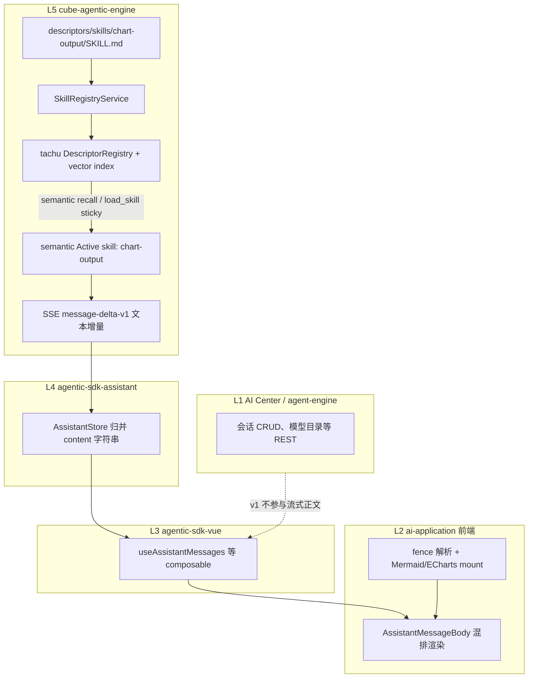
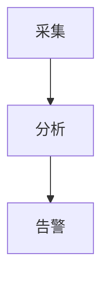

# ADR-0023：AI 助手消息动态图表（Mermaid + ECharts）

| 字段 | 值 |
| --- | --- |
| 状态 | Phase 1 已实现（L2 前端）；Phase 2（L5 engine semantic skill）对齐 `cube-agentic-engine` |
| 日期 | 2026-05-18 |
| 范围 | `@ghcloud/cube-ai-application-app` 助手聊天；**`cube-agentic-engine` 内置 Skill** |
| 关联 | ADR-0021（Reasoning）、ADR-0022（agentic-sdk-vue 全量接入） |
| 决策来源 | Grill-me 多轮对齐 |

## 背景

助手回复正文当前仅支持 Markdown（`markdown-it` + `highlight.js`）经 `v-html` 渲染，**不具备** Mermaid 流程图或 ECharts 统计图的动态绘制能力。业务需要在同一条 AI 消息中混排说明文字与可交互图表。

## 决策摘要

| 项 | 结论 |
| --- | --- |
| 图表类型 | **Mermaid**（流程/架构/时序）+ **ECharts**（折线/柱状/饼图等） |
| v1 技术路线 | **纯 Markdown fenced code block 扩展**，不改 SSE 协议 |
| ECharts 交互 | tooltip、图例切换、dataZoom（档位 2） |
| Mermaid 交互 | 只读展示 |
| 流式 v1 | fence **闭合后**才 mount；未闭合显示「图表生成中…」 |
| 流式后续 | 边流边绘（半闭合 JSON 增量渲染），单独迭代 |
| 语言标签 | 严格仅 `mermaid`、`echarts` |
| 输出约束载体 | **`chart-output` skill**（非各 Agent 手写 Prompt）；由 `descriptors/skills/` 注册并通过 semantic 召回按需激活 |
| v1 交付 | **分仓**：ghcloud **L2 已交付**；`cube-agentic-engine` **L5 另仓** |

## Phase 1 实现（ghcloud L2，2026-05-18）

- `assistant-message-segments.ts`：fence 解析（`mermaid` / `echarts`），闭合前 `chart-pending`。
- `assistant-echarts-option.ts`：JSON 校验 + 危险键黑名单。
- `assistant-message-body.tsx` + `assistant-chart-host.tsx`：混排渲染；`echarts` / `mermaid` 动态 import。
- `assistant-chat.tsx`：助手气泡改用 `AssistantMessageBody`（Reasoning 仍纯 Markdown）。
- 单测：`assistant-message-segments.test.ts`、`assistant-echarts-option.test.ts`、`assistant-chart-fixtures.test.ts`。

## 现状（As-Is，Phase 1 后）

- 渲染入口：`parseMessageSegments` → `AssistantMessageBody`；Markdown 段仍走 `renderAssistantMarkdownToHtml()`。
- 展示：助手正文支持图表混排；用户消息与 Reasoning 不变。
- 协议：SSE `message-delta-v1` 增量拼接字符串；`@cube-ai/agentic-sdk-assistant` 归并为 `content: string`。
- 安全：`markdown-it` 配置 `html: false`，禁止原始 HTML。
- 依赖：已加入 `echarts`（catalog）、`mermaid` ^11。
- **Phase 2 L5**：engine 从 `descriptors/skills/chart-output/SKILL.md` 注册 `chart-output`，开启 tachu vector indexing；统计/可视化意图下 semantic 召回激活，或由 LLM 通过 `load_skill("chart-output")` sticky 加载后输出 fence。

## 架构分层



**v1 原则：**

- **L5**：通过 `chart-output` skill 统一约束模型 chart 输出格式；引擎冷启动扫描 `descriptors/skills/**` 并注册到 tachu，依赖 semantic recall / `load_skill` sticky 按需激活（不依赖租户/Agent 单独配置 Prompt）。
- **L2**：fence 解析与图表 mount（渲染唯一实现层）。
- **L4/L3**：保持 `content: string` 与 SSE 事件不变。
- **L1**：无改动。

---

## 各层职责

### L5 — cube-agentic-engine（v1 与 L2 并列主战场）

| 项 | v1 | 后续 |
| --- | --- | --- |
| 职责 | ① 注册 `chart-output` skill；② 统计/可视化意图下按需激活 skill 上下文；③ 继续下发 `message-delta-v1` | 可选 `chart-block-v1`；Tool `render_chart` |
| 实现 | 见下文 §`chart-output` skill | contracts 新事件；mapper 校验 option |
| 不负责 | Markdown 解析、ECharts/Mermaid DOM mount | 前端渲染 |

#### `chart-output` skill（v1 必做）

| 属性 | 约定 |
| --- | --- |
| **逻辑 ID** | `system:chart-output`（文档与产品语义 ID） |
| **运行时 name** | `chart-output` |
| **路径** | `cube-agentic-engine/descriptors/skills/chart-output/SKILL.md` |
| **trigger** | `semantic` |
| **注册** | `DescriptorLoader` 冷启动扫描 `descriptors/skills/**` → `SkillRegistryService` → 镜像到 tachu `DescriptorRegistry`；`enableVectorIndexing: true` |
| **挂载范围** | 对统计、汇总、趋势、对比、流程图、架构图、ECharts/Mermaid 等语义请求召回激活；未达阈值时作为 Available skill，由 LLM `load_skill("chart-output")` 后 sticky 激活 |
| **内容** | `SKILL.md`（或引擎约定格式）承载下文 §Chart 输出契约全文 + 示例 |
| **版本** | skill 元数据带 `version`（如 `1.0.0`），契约变更时 bump，便于回放与审计 |

**实现落点（`cube-agentic-engine` 仓库，非 ghcloud）：**

1. 新增 `descriptors/skills/chart-output/SKILL.md`。
2. 新增 `SkillRegistryService`，不扩展仅负责 tool 的 `DescriptorRegistryService`。
3. `DescriptorLoader` 冷启动加载 `descriptors/skills/<name>/SKILL.md`；legacy `descriptor.yaml` 兼容。
4. `EngineFactory` 将 skill registry 镜像到 tachu registry，并开启 vector indexing / `recallTopN` / `activationThreshold` / `skillBudget`。
5. **禁止**要求每个 Agent 在控制台重复粘贴图表 Prompt；契约以 engine skill 为运行时真相。

**与 ghcloud 文档关系：** 本 ADR 的 §Chart 输出契约 为 skill 正文**规范源**；实现时同步写入 engine 仓库 skill 文件，两处内容保持一致（engine 为运行时真相，本文件为跨仓设计记录）。

### L6 — 租户 Agent / 控制台 Prompt（v1 降级为可选）

| 项 | v1 | 后续 |
| --- | --- | --- |
| 职责 | 业务域说明、角色人设 | 工具出图、结构化块 |
| 实现 | **不要求**为图表单独写 Prompt；若 Agent 自定义 Prompt 与 skill 冲突，优先遵循已激活的 `chart-output` 输出契约 | 可选引用或禁用 `chart-output`（若产品后续支持 per-agent skill 开关） |
| 不负责 | chart fence 格式定义（已由 L5 skill 承担） | — |

### L4 — `@cube-ai/agentic-sdk-assistant`

| 项 | v1 | 后续 |
| --- | --- | --- |
| 职责 | SSE → `AssistantMessage.content` 累加 | 可选 `contentBlocks[]` |
| 实现 | **无变更** | reducer 识别/缓存 chart 块元数据 |
| 不负责 | DOM、ECharts/Mermaid | UI 组件 |

### L3 — `@cube-ai/agentic-sdk-vue`

| 项 | v1 | 后续 |
| --- | --- | --- |
| 职责 | 暴露 `messages` 等响应式切片 | 可选导出共享 `parseMessageBlocks(content)` |
| 实现 | **无变更** | 避免各业务 App 重复解析逻辑 |
| 建议 | 解析器先放 L2，稳定后再上抽到 L3/L4 | — |

### L2 — `ai-application` 前端（v1 主战场）

| 模块 | 实现内容 |
| --- | --- |
| `assistant-markdown.ts` | 扩展 fence：`mermaid` / `echarts` 输出带 `data-*` 的占位 HTML；不在 markdown-it 内 init 图表库 |
| **新建** `assistant-message-body.tsx` | 替代助手气泡纯 `v-html`；`Segment[]` 混排 |
| **新建** `assistant-chart-host.tsx` | `mermaid.run()` / `echarts.init` + `setOption`；`onUnmounted` dispose |
| `assistant-chat.tsx` | 助手气泡改用 `AssistantMessageBody`；Reasoning 可继续纯 Markdown |
| 依赖 | `mermaid`、`echarts`（建议动态 `import()` 减包） |
| 流式 v1 | 未闭合 fence → `chart-pending`；闭合后 parse + mount |
| 流式后续 | `ChartHost.streamingMode`：防抖、容错、增量 `setOption` |
| 安全 | ECharts 仅 `JSON.parse` + 键白名单；Mermaid `securityLevel: 'strict'` |
| 样式 | 图表容器尺寸、`ResizeObserver`、与 `cube-theme` 对齐 |

### L1 — AI Center（`apps/ai-center` / agent-engine）

| 项 | v1 | 后续 |
| --- | --- | --- |
| 职责 | 租户、Agent、模型、知识库 REST（经 `/api/ai-center/*`） | 图表静态资源上传、审计 |
| 实现 | 助手 SSE 走 `${VITE_AI_CENTER_API_BASE}/agent`；ghcloud `ai-server` 已退役 | 工具出图时的上传接口与鉴权 URL |
| 不负责 | 聊天流式正文渲染（L2 前端） | — |

---

## 数据流（v1）

```
L5 助手 run 组装上下文
  → tachu semantic recall 命中 chart-output（或 LLM load_skill 后 sticky）
  → LLM 按契约输出 Markdown（含 mermaid / echarts fence）
  → message-delta-v1 追加 content
L4 AssistantMessage.content 更新
L3 messages 响应式列表
L2 parseSegments(content)
  → 普通文本: markdown-it HTML
  → 未闭合 fence: 「图表生成中…」
  → 闭合 mermaid: MermaidHost
  → 闭合 echarts: EChartsHost（JSON option + 默认交互）
```

---

## Chart 输出契约（`chart-output` skill 正文）

```text
## 图表输出规范

需要可视化时，使用 fenced code block，语言标签必须严格为以下之一：

1. 流程/架构/时序图 → ```mermaid
2. 数据统计图（折线/柱状/饼图等）→ ```echarts

### Mermaid
- 仅使用 mermaid 标签，内容为合法 Mermaid 语法。
- 单块专注一张图，避免与其它说明混在同一代码块。

### ECharts
- 仅使用 echarts 标签，内容为单个 JSON 对象（ECharts option）。
- 禁止 JavaScript 函数、formatter 字符串、script、外部 URL 加载。
- 数据写在 option 的 series/data 中，字段名使用英文。
- 优先 line / bar / pie；数据点过多时说明可采样。

### 通用
- 图表块前后用简短 Markdown 文字说明结论。
- 一次回复中图表数量建议 ≤ 3。
- 若无法保证 JSON 合法，先用表格呈现，勿输出半截 echarts 块。
```

### 示例

**Mermaid：**

````markdown

````

**ECharts：**

````markdown
```echarts
{
  "title": { "text": "近7日报警趋势" },
  "xAxis": { "type": "category", "data": ["Mon", "Tue", "Wed"] },
  "yAxis": { "type": "value" },
  "series": [{ "type": "line", "data": [12, 20, 15] }]
}
```
````

---

## L2 实现要点

### Segment 模型

```ts
type MessageSegment =
  | { kind: 'markdown'; html: string }
  | { kind: 'chart-pending'; chartType: 'mermaid' | 'echarts' }
  | { kind: 'chart'; chartType: 'mermaid' | 'echarts'; source: string }
  | { kind: 'chart-error'; chartType: 'mermaid' | 'echarts'; message: string }
```

### 闭合检测（流式策略 A）

- 扫描 fenced blocks，语言 ∈ `{ mermaid, echarts }`。
- 无 closing ` ``` ` → `chart-pending`。
- `echarts` 闭合后 `JSON.parse` 失败 → `chart-error`（友好文案 + 可折叠原始内容）。

### ECharts 默认交互（merge 顺序）

`DEFAULT_OPTION` ← 模型 `option`（对危险 key 可设黑名单，禁止覆盖注入脚本类配置）。

```ts
const DEFAULT_ECHARTS_OPTION = {
  tooltip: { trigger: 'axis' },
  legend: {},
  dataZoom: [{ type: 'inside' }, { type: 'slider' }],
}
```

### ChartMountHandle（为流式 C 预留）

```ts
interface ChartMountHandle {
  id: string
  chartType: 'mermaid' | 'echarts'
  update(source: string, closed: boolean): void
  dispose(): void
}
```

- v1：仅 `closed === true` 时 `update`。
- 后续 C：`closed === false` 时防抖 `update`；同一 `id` 优先 `setOption`，避免重复 `init`。

---

## 任务拆分

| ID | 层 | 任务 | 优先级 |
| --- | --- | --- | --- |
| T1 | L2 | `parseMessageSegments(content)` + 单测（闭合/未闭合/非法 JSON） | P0 |
| T2 | L2 | `AssistantMessageBody` + 替换 `assistant-chat` 助手气泡 | P0 |
| T3 | L2 | `MermaidHost` / `EChartsHost` + dispose | P0 |
| T4 | L2 | 依赖接入、样式、主题、ResizeObserver | P0 |
| T5 | L5 | 新增 `descriptors/skills/chart-output/SKILL.md`（`SKILL.md` = §Chart 输出契约） | P0 |
| T6 | L5 | `SkillRegistryService` + `DescriptorLoader` skill 扫描 + tachu skill 镜像/semantic recall + 单测 | P0 |
| T7 | — | 联调：engine skill + 前端渲染（双 fence 混排 SSE 回放） | P0 |
| T8 | L2 | 流式 C：`streamingMode` + 防抖增量渲染 | P2 |
| T9 | L5/L4 | `chart-block-v1` + `blocks[]` | P3 |
| T10 | L5 | 工具出图 + Markdown 图片 | P3 |

---

## 风险与对策

| 风险 | 对策 |
| --- | --- |
| 模型输出非法 JSON | `chart-error` + skill 强调合法 JSON；表格兜底 |
| skill 未注册/未激活 | 引擎启动注册单测 + `skill_recall` 观测 + 联调断言统计/可视化意图可输出合法 fence |
| 流式半截 fence 闪烁 | v1 闭合才 mount；C 阶段防抖 + 不重复 init |
| XSS | 保持 `html: false`；ECharts 不 eval；Mermaid strict |
| 包体积 | 动态 import mermaid/echarts |
| 同页多图 resize | `ResizeObserver` + `chart.resize()` |
| 历史消息 | 依赖已落库 `content`，L2 解析即可 |

---

## 验收标准（v1）

1. 合法 ` ```mermaid ` → 渲染 SVG 流程图（只读）。
2. 合法 ` ```echarts ` → 可悬停、切换图例、缩放。
3. 流式未闭合 fence → 「图表生成中…」，控制台无解析异常。
4. 非法 echarts JSON → 友好错误块，不白屏。
5. 用户消息、Reasoning 区与现网一致。
6. **全新引擎实例**启动后，tachu registry 含 `chart-output`；统计/可视化意图下 semantic 召回激活，或 `load_skill("chart-output")` 后 sticky 激活，并可输出合法 `mermaid` / `echarts` fence。
7. `descriptor.reload` 后 skill 镜像更新；L4/L3/L1 无变更；**v1 发版需 L5 + L2 同版本联调**（或先 engine 后前端，但缺一则无法端到端验收）。

---

## 演进路线

| 阶段 | 内容 | 主要层 |
| --- | --- | --- |
| v1 | semantic `chart-output` skill + Markdown fence + 闭合渲染 | **L5、L2** |
| v1.1 | 工具生成 PNG + `` | L5 Tool |
| v1.2 | 边流边绘（流式 C） | L2（可选 L4 半块合并） |
| v2 | `chart-block-v1` 结构化 SSE | L5 contracts、L4 reducer、L2 块渲染 |

---

## 参考代码

**ghcloud（本仓）**

- `app/src/views/assistant/assistant-markdown.ts`
- `app/src/views/assistant/assistant-chat.tsx`
- ADR-0022：`assistant-chat.tsx` 文件头注释（sdk-vue 接入说明）

**cube-agentic-engine（外仓，v1 需实现）**

- skill 目录：`descriptors/skills/chart-output/SKILL.md`
- 注册：`SkillRegistryService` / `DescriptorLoader.loadSkillsFromDir`
- tachu 对接：`EngineFactory` 镜像 skill registry，开启 vector indexing，依赖 semantic recall / `load_skill` sticky
