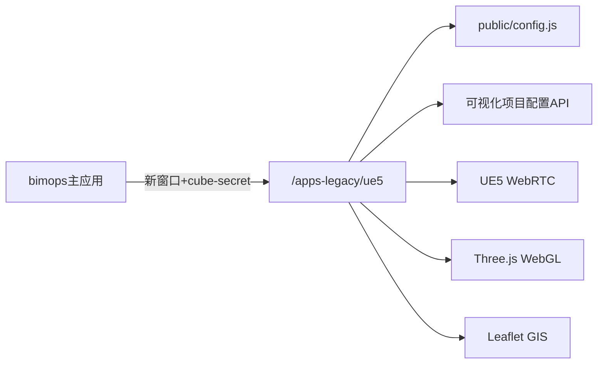

# 01 — 现状架构梳理（legacy/ue5-migrate）

本文描述 [`legacy/ue5-migrate`](../../../../../legacy/ue5-migrate) 当前生产架构，作为迁移基线分析。

## 1. 包信息与规模

| 项 | 值 |
|---|---|
| 包名 | `@ghcloud-legacy/ue5-migrate` |
| 版本 | 1.14.0 |
| 构建 | Vite；`build` 需 `--max-old-space-size=8192`（8GB heap） |
| 部署路径 | `/apps-legacy/ue5`（`vite.config.ts` 中 `projectName = "ue5-migrate"`） |
| 源码规模 | `src/` 下约 1624 个 `.vue/.tsx/.ts` 文件 |
| businessPanel | 104 个顶级域目录；841 个 `.vue` + 367 个 `.tsx` |
| pages/widget | 94 个文件（已基本 TSX 化） |

## 2. 部署与集成



### 2.1 独立 SPA，非 qiankun（legacy 现状）

- UE5 **不是** qiankun 微前端子应用；以独立 SPA 部署，bimops 通过 `openUrlInNewWindow` 在新窗口打开。
- 终端编码：`three-dimensional-visualization`（见 `public/config.js` 中 `terminal` 字段）。

> **目标变更（2026-07）**：迁移后的 `apps/ue5/app` 计划在 **Phase 5** 增加 qiankun 子应用内嵌（`/portal/ue5`），与 standalone 新窗口并存。详见 [02-target-architecture.md §3](./02-target-architecture.md)、[03-migration-plan.md §Phase 5](./03-migration-plan.md)。

### 2.2 运行时配置

[`public/config.js`](../../../../../legacy/ue5-migrate/public/config.js) 在页面加载前注入 `window.config`，包含：

- `tenantConfig`：按租户切换 `entry`（如 `views-2d`、`views-shengNong`）
- `feature`：外链租户、子市场列表、UE5 入口显示名等
- `modelPerspective` / `perspective` / `connectLines`：按租户过滤的模型视角与连线
- `webSocketUrl`：消息 WebSocket 地址

**安全债务**：`config.js` 中存在明文 JWT 示例外链，迁移时应清理或改为后端签发临时 token。

### 2.3 鉴权流程

1. bimops 调用 `getShortSecret("three-dimensional-visualization")` 获取短期密钥
2. 新窗口 URL 携带 `cube-secret` 参数
3. legacy 应用通过 `CubeMfRootGlobalState` 读取 auth，或跳转 `/login`
4. 路由守卫（[`src/router/index.ts`](../../../../../legacy/ue5-migrate/src/router/index.ts)）：无 token 则清 session 并重定向 login

Refactored 路径的 ConfigLoader（[`src/pages/config-loader.ts`](../../../../../legacy/ue5-migrate/src/pages/config-loader.ts)）同样依赖 `CubeMfRootGlobalState.mfRootState.authInfo`。

## 3. 双轨架构（核心债务）

当前存在 **两套并行 Shell**，生产仍走 Legacy 轨。

| 轨道 | 路由入口 | 主文件 | 技术栈 | 状态 |
|---|---|---|---|---|
| **Legacy Shell** | `@/${window.config.entry}/index.vue` | `views/index.vue`（~1643 行） | Vue SFC 单体 | **生产默认** |
| **Refactored Shell** | `pages/index.tsx`（已注释） | `pages/index.tsx` + widget/state/event | TSX + Pinia + ModelSDK | 部分完成，未启用 |

路由证据（refactored 入口被注释）：

```8:18:legacy/ue5-migrate/src/router/index.ts
const routes: Array<RouteRecordRaw> = [
    //   {
    //     path: "/",
    //     name: "home",
    //     component: async () => (await import('@/pages/index')).ViewPage, // 可视化重构入口
    // },
    {
        path: "/",
        name: "home",
        component: async () => import(`@/${window.config.entry??'views'}/index.vue`),// 可视化旧版本入口
    },
```

### 3.1 Legacy Shell 特征

- [`views/index.vue`](../../../../../legacy/ue5-migrate/src/views/index.vue)：巨型单文件，内联 TopHeader、BasePanelRender、设备面板、热力图、场景切换等全部逻辑
- 另有变体入口：
  - [`views-2d/`](../../../../../legacy/ue5-migrate/src/views-2d/)：2D SCADA（11 文件）
  - [`views-3d/`](../../../../../legacy/ue5-migrate/src/views-3d/)：3D 变体（15 文件）
- 租户 `views-shengNong` **不在本仓库**，由 [`legacy/ue5-sn-migrate`](../../../../../legacy/ue5-sn-migrate) 提供

### 3.2 Refactored Shell 特征

- [`pages/index.tsx`](../../../../../legacy/ue5-migrate/src/pages/index.tsx)：Layout + TitleBar + BusinessNav + BasePanelRender + ModelSDK 初始化
- 已基本 TSX 化的子系统：
  - [`pages/widget/`](../../../../../legacy/ue5-migrate/src/pages/widget/)：title-bar、business-nav、modals（94 文件）
  - [`pages/state/`](../../../../../legacy/ue5-migrate/src/pages/state/)：Pinia store 拆分
  - [`pages/event/`](../../../../../legacy/ue5-migrate/src/pages/event/)：事件总线
  - [`pages/model-sdk/`](../../../../../legacy/ue5-migrate/src/pages/model-sdk/)：ModelSDK 门面

**结论**：迁移应以 Refactored Shell 为壳层基线，Legacy Shell 逻辑按功能块逐步吸收或废弃。

## 4. 渲染模式与 ModelSDK

### 4.1 三种 3D/GIS 渲染类型

| renderType | SDK 实现 | 容器 DOM | 依赖 |
|---|---|---|---|
| `UE5` | `UE5SDK` | `<div id="player">` | WebRTC 像素流 |
| `WEBGL` | `WebGlSDK` | `<canvas id="player">` | Three.js 0.155 |
| `GIS` | `WebGisSDK` | Leaflet 地图容器 | `@ghcloud/cube-map-plugins` |

ModelSDK 门面（策略模式）：

```11:22:legacy/ue5-migrate/src/pages/model-sdk/sdk.ts
export class ModelCall {
  private readonly parent: ModelSDK
  public constructor () {
    const { renderType } = useStateStore()
    if (renderType === 'UE5') {
      this.parent = new UE5SDK()
    } else if (renderType === 'GIS'){
      this.parent = new WebGisSDK()
    } else {
      this.parent = new WebGlSDK()
    }
  }
```

初始化流程（refactored 入口）：

1. `ConfigLoader` 拉取后端可视化项目配置，确定 `renderType`、模型路径
2. `modelSDK.initModal(dom)` → 按 renderType 创建播放器
3. `modelSDK.waitModalLoad()` → 等待模型就绪
4. `eventInstance.emitEvent('createBuildIcon')` → 打楼栋标签

### 4.2 2D SCADA 模式

- 租户配置 `entry: 'views-2d'`（如 tenant 60074083 福州广汇）
- 无 ModelSDK 初始化；使用 [`views-2d/index.vue`](../../../../../legacy/ue5-migrate/src/views-2d/index.vue) 作为入口
- 迁移目标：独立 `views/scada-2d/` 路由

## 5. 业务面板（businessPanel）体系

### 5.1 规模

- 104 个顶级域目录（详见 [04-module-inventory.md](./04-module-inventory.md)）
- 841 个 Vue SFC + 367 个 TSX
- TSX 化程度最高的域：`pz-demo`（269 TSX）、`zhongda-heshun`（53 TSX）

### 5.2 卡片注册三件套

现有开发流程（[`legacy/ue5-migrate/README.md`](../../../../../legacy/ue5-migrate/README.md)）：

1. 在 `components/businessPanel/` 下创建卡片组件
2. 在 [`card-register.ts`](../../../../../legacy/ue5-migrate/src/components/businessPanel/base-panel-render/card-register.ts) 注册（key 与 cardDefinition code 一致）
3. 在 [`cube-visual-sdk/src/data-panel/card-definition.ts`](../../../../../prod/cube/basic/cube-visual-sdk/src/data-panel/card-definition.ts) 定义枚举
4. 在 [`panel-definition.ts`](../../../../../prod/cube/basic/cube-visual-sdk/src/data-panel/panel-definition.ts) 组合面板

`card-register.ts` 超过 1200 行，混合 `defineAsyncComponent` 懒加载 Vue 与 TSX 卡片集合（如 `pz_demo_cards`、`command_dispatch_cards`）。

### 5.3 面板渲染

- [`base-panel-render.tsx`](../../../../../legacy/ue5-migrate/src/components/businessPanel/base-panel-render/base-panel-render.tsx) 根据 `panelName` 从 `CardCollective` 取组件渲染
- Legacy Shell 与 Refactored Shell **共用** 同一套 BasePanelRender

## 6. 状态、事件与配置

### 6.1 Pinia Store（Refactored）

[`pages/state/use-state-store.ts`](../../../../../legacy/ue5-migrate/src/pages/state/use-state-store.ts) 为主 store，拆分为：

- `use-state-head.ts` — 头部/标题栏状态
- `use-state-menu.ts` — 业务菜单/场景
- `use-state-area.ts` — 区域/楼栋
- `use-state-other.ts` — 其他全局状态
- `state-init.ts` — 初始化

Legacy Shell 仍使用旧的 pinia store（如 `piniaStoreMenu`），与 refactored store **并存**。

### 6.2 事件总线

[`pages/event/event.ts`](../../../../../legacy/ue5-migrate/src/pages/event/event.ts) 导出 `eventInstance`，注册：

- `register/common.ts` — 通用事件
- `register/model-click.ts` — 模型点击
- `register/gis.ts` — GIS 专属事件

事件名定义于 [`event-name.ts`](../../../../../legacy/ue5-migrate/src/pages/event/event-name.ts)。

### 6.3 ConfigLoader

[`config-loader.ts`](../../../../../legacy/ue5-migrate/src/pages/config-loader.ts) 职责：

1. 从 `CubeMfRootGlobalState` 同步 auth
2. 按 tenant 过滤 `window.config` 中的视角/连线/系统名/entry
3. 调用 `@ghcloud/cube-visualization-service` 与 `getModelConfig` 拉取项目配置
4. 调用 `statusInitialization()` 初始化 Pinia 状态

## 7. HTTP 与依赖层

### 7.1 双 HTTP 层

- Legacy：`src/api/` 下 axios 直调（多个 service 文件）
- Refactored：部分已接 `@ghcloud/cube-visualization-service` 等 workspace 包
- ConfigLoader 混用 `@ghcloud/cube-safety-supervision-app` 的 auth-store

### 7.2 主要 workspace 依赖

| 包 | 用途 |
|---|---|
| `@ghcloud/cube-visual-sdk` | 3D 事件协议、卡片定义 |
| `@ghcloud/cube-visualization-service` | 可视化项目配置 API |
| `@ghcloud/cube-map-plugins` | GIS 地图插件 |
| `@ghcloud/cube-player` | 视频播放器 |
| `@ghcloud/cube-rtc` | 实时通信 |
| `@ghcloud/cube-iot-socket` | IoT WebSocket |
| `@ghcloud/cube-app-design` | CubeLayout 等（refactored 已用） |
| `@ghcloud/cube-mf-root` | 全局 auth 状态 |
| `@ghcloud/generic-component` | Legacy 组件（待移除） |

完整依赖映射见 [04-module-inventory.md](./04-module-inventory.md)。

## 8. 构建与工程配置

| 项 | 现状 |
|---|---|
| TypeScript | `"strict": false`（[`tsconfig.json`](../../../../../legacy/ue5-migrate/tsconfig.json)） |
| 构建内存 | 8GB heap（`package.json` scripts） |
| 路径 alias | `@` → `src/` |
| 资源路径 | `/resource/v1/` 运行时加载（vite external 插件） |
| 多环境 | dev / test / prod / cnp / pz 等 mode |
| 压缩 | vite-plugin-compression |
| Mock | vite-plugin-mock（dev） |

## 9. 已知问题清单

| # | 问题 | 影响 | 迁移处理 |
|---|---|---|---|
| 1 | 双 Shell 并存 | 维护成本高、行为不一致 | Phase 1 启用 TSX Shell，废弃 Legacy |
| 2 | 双 Pinia store | 状态来源不统一 | 合并为单一 store 模块 |
| 3 | 双 HTTP 层 | 鉴权/错误处理不一致 | 统一 `authRequest` + services-client |
| 4 | 8GB 构建 | CI 资源消耗大 | Phase 4 拆 chunk、按需加载 |
| 5 | `strict: false` | 类型安全弱 | Phase 4 逐步收紧 |
| 6 | `views-shengNong` 缺失 | 部分租户无法在本仓库构建 | Phase 3 评估合并 ue5-sn-migrate |
| 7 | config.js 明文 JWT | 安全风险 | 清理敏感数据，改后端签发 |
| 8 | card-register 1200+ 行 | 难以维护 | Phase 2 按域拆分注册表 |
| 9 | 过时文档 | 误导开发 | 以本文档集替代 `项目目录文件说明.md` |

## 10. 目录结构速览

```text
legacy/ue5-migrate/
├── public/
│   └── config.js                 # 运行时 window.config
├── src/
│   ├── views/                    # Legacy Shell 默认入口（~1643 行 index.vue）
│   ├── views-2d/                 # 2D SCADA 入口
│   ├── views-3d/                 # 3D 变体入口
│   ├── pages/                    # Refactored Shell（TSX，未启用）
│   │   ├── index.tsx
│   │   ├── model-sdk/            # UE5 / WebGL / GIS SDK
│   │   ├── state/                # Pinia stores
│   │   ├── event/                # 事件总线
│   │   ├── widget/               # title-bar / nav / modals
│   │   └── config-loader.ts
│   ├── components/
│   │   └── businessPanel/        # 104 域 / 1200+ 卡片
│   ├── api/                      # Legacy HTTP
│   ├── router/index.ts           # 动态 entry 路由
│   └── login/                    # 登录页
└── vite.config.ts
```
