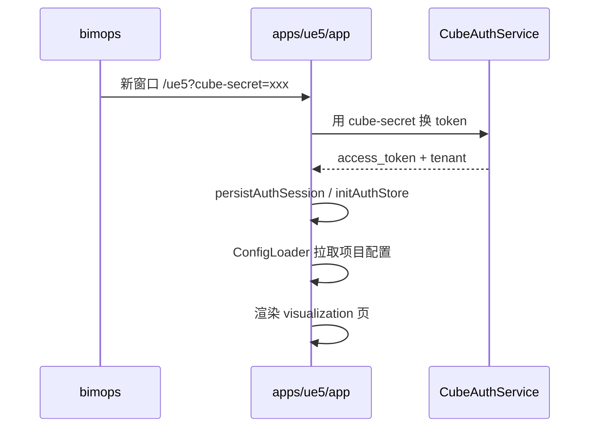
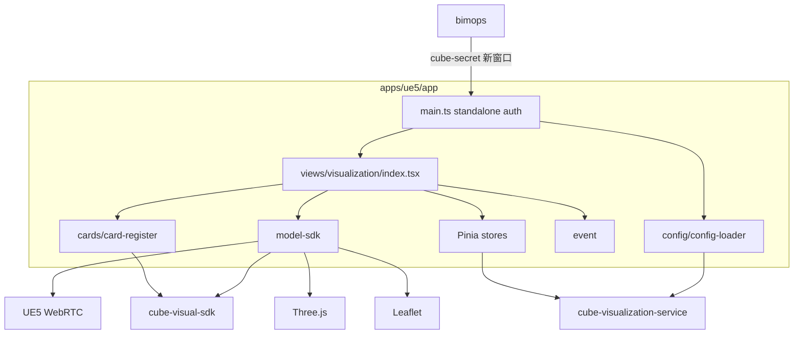

# 02 — 目标架构（apps/ue5/app TSX）

本文描述迁移完成后 `prod/cube/apps/ue5/app` 的目标工程形态。基线脚手架来自 [`prod/cube/template/app`](../../../template/app)，页面与组件 **一律 TSX**。应用 **同时支持** standalone 新窗口（`/ue5`）与 qiankun 子应用内嵌（`/portal/ue5`）；**当前代码仅实现 standalone**，子应用集成列入 Phase 5。

## 1. 工程定位

| 项 | 目标值 |
|---|---|
| 路径 | `prod/cube/apps/ue5/app/` |
| 包名 | `@ghcloud/cube-ue5-app`（脚手架生成） |
| slug | `ue5` |
| 部署路径 | `/ue5`（standalone）；`/portal/ue5`（qiankun 子应用，Phase 5） |
| 集成方式 | bimops 新窗口 + `cube-secret` SSO；portal / bimops 微前端内嵌 + `props.auth`（Phase 5） |
| 页面技术 | TSX（`defineComponent` + JSX） |
| 规范 | [cube-app-development-standard.md](../../../../../.agents/standards/cube-app-development-standard.md) + ADR-0001~0010 |

### 与 visualization service 的关系

```
prod/cube/apps/
├── ue5/
│   ├── app/          ← 渲染端 UI（本文档目标）
│   └── docs/         ← 迁移文档（本目录）
└── visualization/
    └── service/      ← @ghcloud/cube-visualization-service（BFF/API，复用）
```

app 层负责渲染、交互、卡片；service 层负责可视化项目配置、面板定义等后端接口。

## 2. 目标目录结构

> **权威说明**：落地后的目录职责、依赖规则与维护约定见 [`app/STRUCTURE.md`](../app/STRUCTURE.md)。本文 §2 为概要；与 `STRUCTURE.md` 冲突时以 `STRUCTURE.md` 与当前源码为准。

```text
prod/cube/apps/ue5/app/
├── index.html
├── package.json
├── vite.config.ts
├── vite.dev.config.ts
├── .env.example
└── src/
    ├── main.ts                 # 双模式启动（Phase 5：renderWithQiankun + standalone）
    ├── app.ts                  # Application 类：Vue / Router / Pinia 装配
    ├── app.tsx                 # 根组件 ConfigProvider
    ├── logger.ts
    ├── constants/
    │   ├── env.ts              # APPLICATION_CODE、路由前缀
    │   └── render-type.ts      # UE5 / WEBGL / GIS 枚举
    ├── api/
    │   ├── auth-store.ts
    │   ├── session.ts          # cube-secret URL 同步（参考 inspection-command-screen）
    │   └── visualization-service.ts
    ├── permission/
    ├── router/
    │   └── index.ts            # 仅 / 与 /login
    ├── stores/                 # Pinia（从 pages/state 迁移）
    │   ├── use-visualization-store.ts
    │   ├── use-panel-store.ts
    │   └── use-menu-store.ts
    ├── views/
    │   ├── visualization/      # 主 3D/GIS 页（对应 legacy pages/index.tsx）
    │   │   ├── index.tsx
    │   │   └── visualization.module.less
    │   ├── scada-2d/           # 2D SCADA（对应 legacy views-2d）
    │   │   └── index.tsx
    │   └── login/
    │       └── index.tsx
    ├── widgets/                # 从 legacy pages/widget 迁移
    │   ├── title-bar/
    │   ├── business-nav/
    │   ├── area-nav/
    │   └── modals/
    ├── model-sdk/              # UE5SDK / WebGlSDK / WebGisSDK
    │   ├── sdk.ts
    │   ├── ue-sdk.ts
    │   ├── web-gl-sdk.ts
    │   └── web-gis.ts
    ├── event/                  # 事件总线
    │   ├── event.ts
    │   ├── event-core.ts
    │   └── register/
    ├── cards/                  # 从 businessPanel 按域迁移
    │   ├── _register/          # card-register 按域拆分（overview / security-overview / universal-panel + 聚合）
    │   ├── card-register.ts    # 注册表聚合入口
    │   ├── overview/
    │   ├── security/
    │   └── ...
    ├── config/
    │   └── config-loader.ts    # 配置加载
    └── assets/
```

### 目录职责说明

| 目录 | 职责 | 来源 |
|---|---|---|
| `views/visualization/` | 主可视化页面壳层 | `legacy/.../pages/index.tsx` |
| `widgets/` | 可复用 UI 块（标题栏、导航、弹窗） | `legacy/.../pages/widget/` |
| `model-sdk/` | 渲染引擎抽象 | `legacy/.../pages/model-sdk/` |
| `event/` | 模型/UI 事件分发 | `legacy/.../pages/event/` |
| `cards/` | 业务数据卡片 | `legacy/.../components/businessPanel/` |
| `stores/` | 全局状态 | `legacy/.../pages/state/` |
| `config/` | 运行时/后端配置加载 | `legacy/.../pages/config-loader.ts` |

详见 [`app/STRUCTURE.md`](../app/STRUCTURE.md) 完整职责表与依赖方向。

## 3. 集成与鉴权

### 3.1 双模式启动（目标架构）

应用需同时支持 **standalone** 与 **qiankun 子应用** 两种挂载方式，共用同一套 `Application` 类与可视化壳层。参考 [`inspection-command-screen/app/src/main.ts`](../../inspection-command-screen/app/src/main.ts)。

| 模式 | 触发条件 | 路由 base | 典型入口 |
|---|---|---|---|
| Standalone | `!qiankunWindow.__POWERED_BY_QIANKUN__` | `/ue5` | bimops 新窗口 `/ue5?cube-secret=...` |
| Qiankun 子应用 | 主应用路由激活 / `loadMicroApp` | `/portal/ue5` | portal 菜单内嵌 |

**当前实现（2026-07）**：仅 standalone（`app.ts` 直挂 `Application`）；qiankun 生命周期与双 base **尚未接入**，列入 Phase 5。

```typescript
// 目标 main.ts 骨架（Phase 5 实施）
const qiankunAppBase = "/portal/ue5";
const standaloneAppBase = "/ue5";

class Main {
  private app?: Application;

  private async mountApp(props?: QiankunProps): Promise<void> {
    const auth = await bootstrapAuth(props);
    const base = qiankunWindow.__POWERED_BY_QIANKUN__ ? qiankunAppBase : standaloneAppBase;
    this.app = new Application({ base, auth });
    await this.app.install();
  }

  run() {
    renderWithQiankun({
      bootstrap: async () => {},
      mount: async (props) => { await this.mountApp(props); },
      unmount: async () => { await this.app?.uninstall(); },
      update: async () => {},
    });
    if (!qiankunWindow.__POWERED_BY_QIANKUN__) {
      this.mountApp().catch(console.error);
    }
  }
}
```

> **Phase 1 历史决策**：脚手架阶段为加速 standalone 验收，曾移除 `vite-plugin-qiankun` 与 `main.ts` 双模式分支。产品需求变更（2026-07）后，Phase 5 将 **恢复** 与 inspection-command-screen 一致的双模式结构。

### 3.2 cube-secret SSO 流程（Standalone）

参考 [`inspection-command-screen/app/src/application/auth/session.ts`](../../inspection-command-screen/app/src/application/auth/session.ts)：



关键步骤：

1. `syncAuthFromUrl()` — 解析 URL 中 `cube-secret`，调用 `CubeAuthService` 换取 token
2. fallback 读 `sessionStorage`（`GH-Token` / `GH-NowEnterprise`）
3. `persistAuthSession()` — 写入 session 并 `initAuthStore`
4. 无 auth 时跳转 `/login`

### 3.3 Qiankun 内嵌鉴权（Phase 5）

子应用模式下，主应用通过 qiankun `props` 下发 `auth`（与 `CubeMfRootGlobalState` 对齐）：

1. `bootstrapAuth(props)` — 优先 `props.auth`，其次 URL `cube-secret`，再次 session / `getAuthInfo()`
2. 路由 `base` 使用 `/portal/ue5`，避免与主应用 history 冲突
3. `unmount` 必须调用 `Application.uninstall()`，并清理 ModelSDK、WebSocket、定时器等长生命周期资源

**bimops / portal 侧（Phase 5 协作）**

- 在微应用注册表中增加 `ue5` 条目（name、entry、activeRule、container）
- 菜单配置支持「内嵌打开」与「新窗口打开」两种终端行为（可并存）

### 3.4 路由

仅保留两路由，**删除** dynamic `window.config.entry` 机制：

| 路径 | 组件 | 说明 |
|---|---|---|
| `/` | `views/visualization/index.tsx` | 默认 3D/GIS 可视化 |
| `/login` | `views/login/index.tsx` | 独立登录（无 cube-secret 时） |

2D SCADA 通过 ConfigLoader 判定 `renderType` 或租户配置，路由级重定向至 `/scada-2d`（Phase 3）。

## 4. 目标运行时架构



### 主可视化页结构（TSX）

对应 legacy `pages/index.tsx`，目标写法：

```tsx
// views/visualization/index.tsx（示意）
export const VisualizationPage = defineComponent({
  setup: () => {
    useIotSocket();
    const { renderType, globalState } = useVisualizationStore();
    const modelContainer = ref<HTMLElement>();

    onMounted(async () => {
      await modelSDK.initModal(modelContainer.value!);
      await modelSDK.waitModalLoad();
      eventInstance.emitEvent("createBuildIcon");
    });

    return () => (
      <Layout v-slots={{
        "layout-header": () => <TitleBar />,
        "layout-left-penal": () => <BasePanelRender position="left" ... />,
        "layout-right-penal": () => <BasePanelRender position="right" ... />,
        "layout-menu": () => <BusinessNav />,
      }}>
        {renderType === "WEBGL" && <canvas id="player" ref={modelContainer} />}
        {renderType === "UE5" && <div id="player" ref={modelContainer} />}
        {renderType === "GIS" && <GisMapContainer ref={modelContainer} />}
      </Layout>
    );
  },
});
```

## 5. Cube 规范适配

### 5.1 Legacy → Target 映射

| Legacy 做法 | 目标做法 | ADR |
|---|---|---|
| `axios` 直调 `src/api/` | `@ghcloud/cube-services-client` + `authRequest` | 0003, 0004 |
| `@ghcloud/generic-component` | `@ghcloud/cube-ui` / `@ghcloud/cube-app-design` | 0005 |
| Vue SFC 卡片 | TSX 卡片；存量 Vue 临时兼容 | 0005 |
| `window.config` 全量运行时 | Phase 1 保留 `config.js`；Phase 4 迁 env + 后端 API | 0007 |
| `CubeMfRootGlobalState` | standalone `session.ts` + `authRequest.updateAuth` | 0004, 0008 |
| `lodash` 直依赖 | `@ghcloud/cube-utils` | 0006 |
| 目录自创结构 | 跟 template/app + 本文档扩展目录 | 0001 |

### 5.2 UI 组件栈

```text
@ghcloud/cube-app-design   # CubeLayout、useCubeForm 等（面板壳层）
@ghcloud/cube-ui           # Button、Modal、Page 等
ant-design-vue             # cube-ui 未覆盖时少量使用
echarts                    # 卡片图表（按需，参见 ADR-0009 独立模板）
```

可视化大屏 **不强制** 使用 `useCubeTable` 列表模式；以 `CubeLayout` + 自定义 slot 为主，参考 [`inspection-command-screen`](../../inspection-command-screen/app/src/views/dashboard/index.tsx)。

### 5.3 卡片注册协议（保持不变）

迁移后仍遵循三件套：

1. `src/features/cards/<domain>/<card-name>.tsx` — 卡片组件（TSX）
2. `src/features/cards/card-register.ts` — 注册（key = cardDefinition code）
3. `prod/cube/basic/cube-visual-sdk/src/data-panel/` — card-definition + panel-definition

**改进**：`card-register.ts` 按域拆分为 `cards/overview/register.ts`、`cards/pz-demo/register.ts` 等，由 `cards/index.ts` 聚合。

### 5.4 配置策略（分期）

| 阶段 | 配置来源 |
|---|---|
| Phase 1 | 保留 `public/config.js`（`window.config`）+ 后端 API |
| Phase 3 | 租户 entry/2D 配置迁入后端或 env |
| Phase 4 | 移除 `config.js` 敏感字段；纯 env + API |

## 6. 部署与路径

### 6.1 nginx 映射（目标）

| 路径 | 指向 |
|---|---|
| `/ue5/` | `apps/ue5/app` 构建产物 |
| `/apps-legacy/ue5/` | 灰度期可反向代理至同一产物 |

### 6.2 bimops 入口（双模式）

[`choose-terminal-dropdown.vue`](../../../../../legacy/bimops-fe-web-migrate/src/components/NavTopLink/components/choose-terminal-dropdown/choose-terminal-dropdown.vue) 及相关终端配置：

| 打开方式 | 当前 | 目标 |
|---|---|---|
| 新窗口（standalone） | `/apps-legacy/ue5?cube-secret=...` | `/ue5?cube-secret=...`（Phase 1 验收后切流） |
| 主应用内嵌（qiankun） | 未支持 | `/portal/ue5` 路由激活（**Phase 5**） |

```typescript
// 新窗口 — 保持不变
openUrlInNewWindow("/ue5", { "cube-secret": cubeSecret });

// 内嵌 — Phase 5 由主应用路由 / 菜单驱动，无需新窗口 API
```

或通过终端 `aliasPath` 配置切换，支持灰度。

### 6.3 vite 配置要点

| 项 | 值 |
|---|---|
| `projectName` | `ue5` |
| standalone base | `/ue5` |
| qiankun base（Phase 5） | `/portal/ue5` |
| qiankun name | `ue5`（与 `projectName` 一致） |
| 挂载 id | `Ue5`（PascalCase） |
| `@cube-theme-antd3-scope-selector` | `#Ue5` |
| `applicationCode` | `three-dimensional-visualization` |
| 构建内存 | 目标 Phase 4 降至 ≤4GB（拆 chunk） |
| `vite-plugin-qiankun` | Phase 5 恢复接入 |

## 7. 参考实现

| 场景 | 参考 |
|---|---|
| TSX 大屏页面 | [`inspection-command-screen/.../dashboard/index.tsx`](../../inspection-command-screen/app/src/views/dashboard/index.tsx) |
| **双模式 main + qiankun** | [`inspection-command-screen/.../main.ts`](../../inspection-command-screen/app/src/main.ts) |
| standalone auth + cube-secret | [`inspection-command-screen/.../api/session.ts`](../../inspection-command-screen/app/src/application/auth/session.ts) |
| 另一双模式参考 | [`video-monitor/app/src/main.ts`](../../video-monitor/app/src/main.ts) |
| Refactored 壳层 | [`legacy/ue5-migrate/src/pages/`](../../../../../legacy/ue5-migrate/src/pages/) |
| ModelSDK | [`legacy/ue5-migrate/src/pages/model-sdk/`](../../../../../legacy/ue5-migrate/src/pages/model-sdk/) |
| 脚手架基线 | [`prod/cube/template/app`](../../../template/app) |
| 卡片协议 | [`cube-visual-sdk/src/data-panel/`](../../../basic/cube-visual-sdk/src/data-panel/) |

## 8. 非目标（按阶段）

| 项 | 阶段 |
|---|---|
| qiankun 生命周期与双 base | **Phase 5**（已纳入计划，当前不开发） |
| 合并 `ue5-sn-migrate` | Phase 3 单独评估 |
| Phase 1 迁移全部 104 个 businessPanel 域 | 已按优先级分批完成主体 |
| 修改 `cube-visual-sdk` 的 card-definition 协议 | 不在范围 |
