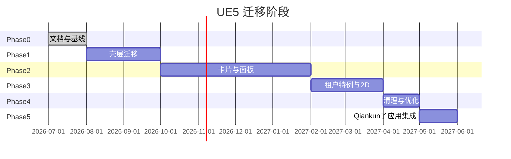

# 03 — 分期改造计划

本文给出从 [`legacy/ue5-migrate`](../../../../../legacy/ue5-migrate) 到 [`prod/cube/apps/ue5/app`](../app) 的分阶段迁移路线、验收标准与路径切换策略。

## 总览



| 阶段 | 名称 | 优先级 | 核心交付 |
|---|---|---|---|
| Phase 0 | 文档与基线 | — | 本文档集（当前交付） |
| Phase 1 | 壳层迁移 | P0 | 可运行的 TSX standalone app |
| Phase 2 | 卡片与面板 | P1 | 按租户/项目迁移 businessPanel |
| Phase 3 | 租户特例与 2D | P2 | scada-2d、ue5-sn 评估 |
| Phase 4 | 清理与优化 | P3 | 下线 legacy、构建优化 |
| **Phase 5** | **Qiankun 子应用集成** | **P1** | **双模式：standalone + `/portal/ue5` 内嵌（2026-07 计划新增，暂不开发）** |

---

## Stage A/B/C/D — 全 TSX + 目录简化（2026-07）

在 Phase 1–2 之上追加的硬约束改造，详见计划文档（不修改 plan 文件本身）。目录权威说明：[`app/STRUCTURE.md`](../app/STRUCTURE.md)。

| Stage | 名称 | 核心交付 | 验收 |
|---|---|---|---|
| **A** | 目录重组 + 文档 | `pages/` → `widgets/` / `stores/` / `config/` 等；新建 `STRUCTURE.md`；删除 template 死代码 | `build:dev` 通过 |
| **B** | 壳层零 `.vue` + 切流 | `shared/panel`、`views/login`、`equipment`、壳层 TSX 化 | `check:no-vue:shell`；`/ue5` E2E |
| **C** | 卡片域 TSX 化 | 按 [`04-module-inventory.md`](./04-module-inventory.md) 优先级逐域；`cards/_register/` 按域拆分 | `check:no-vue`；域 smoke |
| **D** | 2D / SN 特例 | `views/scada-2d/index.tsx`；`ue5-sn-migrate` 独立评估 | Phase 3 验收 |

### Stage 验收脚本（`app/package.json`）

```bash
bun run check:no-vue          # src/ 下零 .vue
bun run check:no-vue:shell    # cards/ 外零 .vue（切流前壳层门禁）
bun run build:dev             # 全量构建
```

### card-register 拆分

- `cards/_register/overview.ts` — P0 总览域
- `cards/_register/security-overview.ts` — 安全 2.0 总览
- `cards/_register/universal-panel.ts` — 通用面板
- `cards/_register/card-register.ts` — 聚合其余域 + spread 导入
- `cards/_register/index.ts` — 对外 re-export

---

## Phase 0 — 文档与基线（本次交付）

### 目标

建立迁移共识与模块清单，不涉及代码变更。

### 交付物

- [`README.md`](../README.md)
- [`PROGRESS.md`](../PROGRESS.md) — **迁移进度（每步更新已完成 / 待补充）**
- [`docs/01-current-architecture.md`](./01-current-architecture.md)
- [`docs/02-target-architecture.md`](./02-target-architecture.md)
- [`docs/03-migration-plan.md`](./03-migration-plan.md)（本文）
- [`docs/04-module-inventory.md`](./04-module-inventory.md)

### 路径策略确认

| 环境 | legacy 路径 | standalone 目标 | qiankun 目标（Phase 5） | 策略 |
|---|---|---|---|---|
| 生产 | `/apps-legacy/ue5` | `/ue5` | `/portal/ue5` | 灰度期 legacy 与 `/ue5` 可指向同一构建产物 |
| bimops 新窗口 | `openUrlInNewWindow("/apps-legacy/ue5")` | `openUrlInNewWindow("/ue5")` | — | Phase 1 验收后切换 |
| bimops / portal 内嵌 | 未支持 | — | 主应用微应用路由激活 | **Phase 5** |

---

## Phase 1 — 壳层迁移（P0）

### 目标

创建可独立运行的 `apps/ue5/app`，以 Refactored Shell 替换 Legacy Shell，打通 bimops SSO。

### 任务清单

| # | 任务 | 说明 |
|---|---|---|
| 1.1 | 脚手架 | `cd prod/cube/template/app && bun run scaffold`，slug=`ue5` |
| 1.2 | 调整 standalone | Phase 1 移除 qiankun 以加速验收；**Phase 5** 恢复双模式（见 §Phase 5） |
| 1.3 | 迁移壳层 | `pages/index.tsx` → `views/visualization/index.tsx` |
| 1.4 | 迁移 widgets | `pages/widget/` → `widgets/` |
| 1.5 | 迁移 ModelSDK | `pages/model-sdk/` → `model-sdk/` |
| 1.6 | 迁移 state | `pages/state/` → `stores/` |
| 1.7 | 迁移 event | `pages/event/` → `event/` |
| 1.8 | 迁移 ConfigLoader | `pages/config-loader.ts` → `config/config-loader.ts` |
| 1.9 | 实现 session.ts | cube-secret URL 同步 + session fallback |
| 1.10 | 路由简化 | 仅 `/` + `/login`；删除 dynamic entry |
| 1.11 | 迁移 card-register | 原样迁入 `cards/card-register.ts`（暂不拆分） |
| 1.12 | 保留 config.js | `public/config.js` 继续注入 window.config |
| 1.13 | nginx 配置 | `/ue5` 指向新构建产物；legacy 路径可代理 |

### 不迁移（Phase 1 范围外）

- Legacy `views/index.vue` 内联逻辑（按功能块在 Phase 2 评估是否需要）
- 全部 businessPanel 卡片（保持 card-register 懒加载引用 legacy 路径或 symlink）
- `views-shengNong`（独立仓库）
- 2D SCADA 入口

### 验收标准

- [ ] bimops 新窗口打开 `/ue5?cube-secret=...` 完成 SSO，进入可视化页
- [ ] 至少一个 renderType（UE5 / WEBGL / GIS）完成 E2E：模型加载 → 面板展示 → 事件响应
- [ ] 登录页在无 cube-secret 时可独立登录
- [ ] ConfigLoader 正确拉取可视化项目配置
- [ ] title-bar / business-nav / 左右面板 slot 正常渲染
- [ ] 构建产物可通过 nginx 部署

### 风险与缓解

| 风险 | 缓解 |
|---|---|
| card-register 引用 legacy 路径导致构建失败 | Phase 1 先整体复制 businessPanel 目录，或保持 `@ghcloud-legacy/ue5-migrate` 依赖 |
| CubeMfRootGlobalState 依赖 | 用 session.ts 完全替代，移除 mf-root 依赖 |
| 8GB 构建 | Phase 1 可暂保留大内存；Phase 4 优化 |

---

## Phase 2 — 卡片与面板（P1）

### 目标

按租户/项目优先级，将 businessPanel 卡片迁移至 `cards/`，新卡片一律 TSX。

### 迁移优先级建议

| 优先级 | 域 | 理由 | Vue | TSX |
|---|---|---|---|---|
| P0 | `overview` | 总览面板，多数项目使用 | 14 | 0 |
| P0 | `security-overview` | 安防总览 | 23 | 0 |
| P0 | `universal-panel` | 通用面板 | 23 | 0 |
| P1 | `command-dispatch-v2` | 已 TSX 化 | 0 | 7 |
| P1 | `parking-car` | 已 TSX 化 | 0 | 10 |
| P1 | `people-flow` | 部分 TSX | 1 | 6 |
| P1 | `safety-manage-cards` | 已 TSX 化 | 0 | 6 |
| P2 | `pz-demo` | 大量 TSX（269），平湖等项目 | 34 | 269 |
| P2 | `zhongda-heshun` | 中大合顺定制（53 TSX） | 3 | 53 |
| P3 | 其余 ~95 域 | 按租户需求驱动 | — | — |

完整域清单见 [04-module-inventory.md](./04-module-inventory.md)。

### 任务清单

| # | 任务 | 说明 |
|---|---|---|
| 2.1 | 拆分 card-register | 按域拆为 `cards/<domain>/register.ts` |
| 2.2 | TSX 改写 | 新卡片一律 TSX；存量 Vue 用兼容层或逐张改 |
| 2.3 | 移除 generic-component | 替换为 cube-ui / cube-app-design |
| 2.4 | 统一 HTTP | axios 直调 → authRequest + services-client |
| 2.5 | 卡片单元测试 | 关键卡片加 snapshot / 渲染测试（可选） |

### Vue 卡片兼容策略

| 策略 | 适用 | 说明 |
|---|---|---|
| **A. 逐张改 TSX** | 小卡片、高频维护 | 长期推荐 |
| **B. Vue 兼容层** | 大卡片、低变更 | `@vitejs/plugin-vue` 保留，card-register 继续 `defineAsyncComponent` 加载 `.vue` |
| **C. 废弃** | demo-panel 等演示域 | 确认无租户使用后删除 |

### 验收标准

- [ ] 目标租户的全部面板卡片可正常渲染
- [ ] 卡片与 ModelSDK 事件联动正常（点击模型 → 面板切换）
- [ ] card-register 按域拆分，单文件 < 300 行
- [ ] 新卡片 100% TSX

---

## Phase 3 — 租户特例与 2D（P2）

### 目标

处理非标准入口与独立仓库。

### 3.1 2D SCADA

| 项 | 说明 |
|---|---|
| 现状 | `entry: views-2d`，[`views-2d/index.vue`](../../../../../legacy/ue5-migrate/src/views-2d/index.vue) |
| 目标 | `views/scada-2d/index.tsx` |
| 路由 | ConfigLoader 判定 2D 配置时 redirect 至 `/scada-2d` |
| 文件量 | 11 个（较小，可整体迁移） |

### 3.2 海吉星 shengNong

| 项 | 说明 |
|---|---|
| 现状 | `entry: views-shengNong`，代码在 [`legacy/ue5-sn-migrate`](../../../../../legacy/ue5-sn-migrate) |
| 租户 | config.js 中 tenant 21481321、24894805、62220897 |
| 选项 A | 合并入 `apps/ue5/app`，按 tenant 加载 shengNong 模块 |
| 选项 B | 独立 `apps/ue5-sn/app` |
| 建议 | 先评估 ue5-sn-migrate 与 ue5-migrate 的代码重叠度，再决策 |

### 3.3 views-3d 变体

- 15 文件，评估是否可被 `views/visualization` 统一（通过 ConfigLoader 配置差异）

### 验收标准

- [ ] 2D 租户（如福州广汇）可正常打开 SCADA 页
- [ ] shengNong 租户有明确迁移方案（合并或独立 app）
- [ ] 不再依赖 dynamic `window.config.entry` 切换 Shell

---

## Phase 4 — 清理与优化（P3）

### 目标

下线 legacy，优化构建与代码质量。

### 任务清单

| # | 任务 | 说明 |
|---|---|---|
| 4.1 | 下线 legacy | 停止发布 `@ghcloud-legacy/ue5-migrate`；nginx 移除 `/apps-legacy/ue5` |
| 4.2 | 删除双轨代码 | 移除 `views/index.vue`、`views-3d/` 等 Legacy Shell |
| 4.3 | 构建优化 | 拆 chunk、按需加载卡片；目标 ≤4GB heap |
| 4.4 | TS strict | 逐步开启 `"strict": true` |
| 4.5 | 清理 config.js | 移除明文 JWT；敏感配置迁后端 |
| 4.6 | 文档归档 | 标记 legacy README 为 archived；本文档集为主入口 |
| 4.7 | 移除兼容层 | 全部 Vue 卡片改 TSX 后移除 `@vitejs/plugin-vue`（若不再需要） |

### 验收标准

- [ ] CI 标准内存（≤4GB）下 build 通过
- [ ] 无 legacy 路径访问
- [ ] `config.js` 无敏感信息
- [ ] `"strict": true` 或至少无 `@ts-ignore` 新增

---

## Phase 5 — Qiankun 子应用集成（P1，2026-07 计划新增）

> **说明**：产品需求由「仅 standalone 新窗口」调整为「standalone + qiankun 双模式」。本阶段 **仅文档规划，暂不开发**；待 Phase 1 standalone 切流与 TSX 运行时稳定后再实施。

### 目标

同一套 `apps/ue5/app` 构建产物，既可被 bimops **新窗口**打开，也可被 portal / bimops **微前端容器内嵌**。

### 任务清单

| # | 任务 | 说明 |
|---|---|---|
| 5.1 | 恢复 `vite-plugin-qiankun` | `qiankunAppBase = "/portal/ue5"`，`projectName = "ue5"` |
| 5.2 | 双模式 `main.ts` | `renderWithQiankun` + standalone 直挂，参考 inspection-command-screen |
| 5.3 | `bootstrapAuth(props)` | 优先 `props.auth`，其次 cube-secret / session |
| 5.4 | 动态 router base | qiankun 模式 `/portal/ue5`，standalone 模式 `/ue5` |
| 5.5 | unmount 资源清理 | ModelSDK、WebSocket、定时器 |
| 5.6 | 主应用微应用注册 | bimops / portal 增加 `ue5` 条目 |
| 5.7 | 菜单双入口 | 「内嵌打开」与「新窗口打开」可并存 |

### 验收标准

- [ ] 主应用内嵌 `/portal/ue5` 可加载，auth 来自 `props.auth`
- [ ] standalone `/ue5?cube-secret=...` 与 Phase 1 行为一致
- [ ] unmount 后无残留 WebSocket / 定时器
- [ ] 3D / 2D 至少各一种租户在内嵌模式下走通主链路

### 参考

- [`inspection-command-screen/app/src/main.ts`](../../inspection-command-screen/app/src/main.ts)
- [`video-monitor/app/src/main.ts`](../../video-monitor/app/src/main.ts)
- [02-target-architecture.md §3](./02-target-architecture.md)
- [05-migration-transformation.md §3.2](./05-migration-transformation.md)

---

## 全局验收标准（每阶段）

| 检查项 | 说明 |
|---|---|
| SSO | bimops 新窗口 + cube-secret 登录成功；Phase 5 增加内嵌 auth 透传 |
| 渲染 | 至少一种 renderType E2E 通过（standalone）；Phase 5 增加内嵌模式 |
| 面板 | 卡片渲染 + ModelSDK 事件联动 |
| 构建 | 产物可部署、可访问 |
| 回归 | 目标租户核心场景无功能回退 |

## 依赖与协作

| 协作方 | 内容 | 阶段 |
|---|---|---|
| bimops 团队 | 新窗口路径 `/apps-legacy/ue5` → `/ue5` | Phase 1 |
| bimops / portal | 微应用注册 `ue5`、菜单内嵌路由 | **Phase 5** |
| 运维 / nginx | 配置 `/ue5` 路由 | Phase 1 |
| cube-visual-sdk | card-definition 新增卡片枚举 | Phase 2 |
| visualization service | 配置 API 稳定性 | Phase 1+ |
| ue5-sn 仓库 | 合并或独立 app 决策 | Phase 3 |

## 不在范围

- 不修改 UE5 流媒体服务端
- 不在 Phase 0/1 迁移全部 104 个 businessPanel 域
- **Phase 5 之前**不实施 qiankun 代码改造（已纳入计划，非永久排除）
