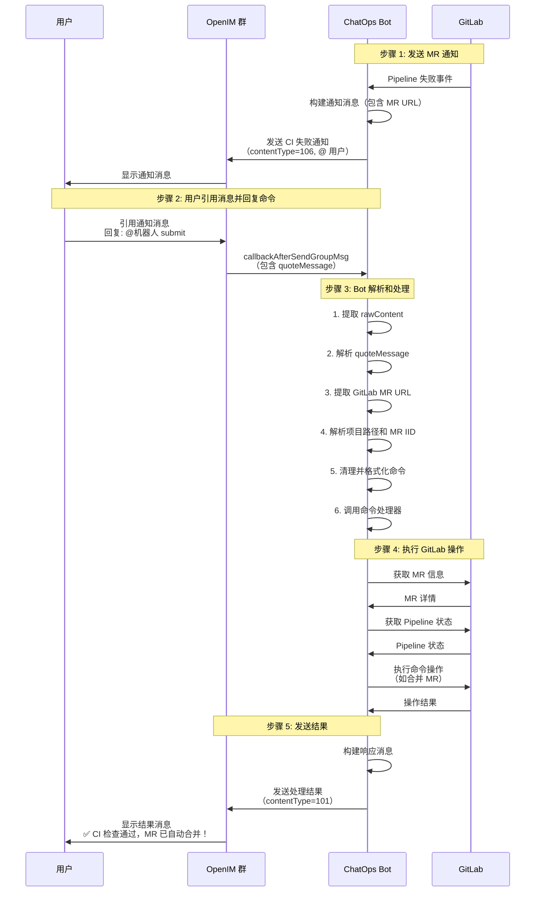

# OpenIM 引用消息命令处理指南

本文档说明如何在 OpenIM 群中通过引用机器人发送的 GitLab MR 通知消息来执行命令。

## 功能概述

当机器人在 OpenIM 群中发送 GitLab MR 相关通知（如 CI 失败、审核通知等）时，用户可以直接引用该消息并回复命令，系统会自动识别 MR 信息并执行相应的操作。

## 使用场景

### 场景 1：CI 失败后重新触发

1. **机器人发送 CI 失败通知**：

```
❌ 【CI】CI 检查失败

项目: ghcloud-test
合并请求: Update readme.md
链接: http://git.guhecloud.com:8000/ghcloud/ghcloud-test/-/merge_requests/14
状态: CI Pipeline 执行失败

请检查 CI 日志并修复问题后重新提交。
@但科
```

2. **用户引用消息并回复命令**：

```
[引用上面的消息]
@机器人 ci
```

或者：

```
[引用上面的消息]
@7388116624 submit
```

3. **系统自动处理**：
   - 解析引用消息中的 MR URL
   - 提取项目路径（`ghcloud/ghcloud-test`）和 MR IID（`14`）
   - 执行 `/ci` 或 `/submit` 命令
   - 将处理结果发送回群

### 场景 2：审核通知后直接提交

1. **机器人发送审核通知**：

```
🔔 【CI】【创建】代码审核通知

项目: ghcloud-test
合并请求: feat(test): 添加新功能
链接: http://git.guhecloud.com:8000/ghcloud/ghcloud-test/-/merge_requests/15
发起人: zhangsan
审核者: lisi、wangwu

请及时进行代码审核。
@李四 @王五
```

2. **审核者引用消息并回复**：

```
[引用上面的消息]
@机器人 submit
```

3. **系统自动处理**：
   - 检查 CI 状态
   - 如果 CI 通过，自动合并 MR
   - 如果 CI 未通过，重新触发 CI

## 支持的命令

所有 GitLab MR 评论命令都支持通过引用消息执行：

### 1. `/submit` - 自动提交合并

**功能**：检查 CI 状态，如果通过则自动合并 MR

**用法**：

```
[引用 MR 通知消息]
@机器人 submit
```

或者使用别名：

```
[引用 MR 通知消息]
@机器人 merge
```

### 2. `/ci` - 重新触发 CI

**功能**：重新触发 CI Pipeline

**用法**：

```
[引用 MR 通知消息]
@机器人 ci
```

### 3. `/review` - AI 代码审查

**功能**：使用 AI 进行代码审查

**用法**：

```
[引用 MR 通知消息]
@机器人 review
```

### 4. `/reviewer` - 指定审核者

**功能**：添加审核者并发送通知

**用法**：

```
[引用 MR 通知消息]
@机器人 reviewer @user1 @user2
```

### 5. `/cc` - 发送抄送通知

**功能**：发送抄送通知给指定用户

**用法**：

```
[引用 MR 通知消息]
@机器人 cc @user1 @user2
```

或带额外消息：

```
[引用 MR 通知消息]
@机器人 cc @user1 请知悉这个变更
```

### 6. `/help` - 显示帮助

**功能**：显示命令帮助信息

**用法**：

```
[引用 MR 通知消息]
@机器人 help
```

## 命令格式说明

### 支持的格式

1. **@ 机器人 ID + 命令**（推荐）：

```
@7388116624 submit
@7388116624 ci
@7388116624 review
```

2. **@ 机器人用户名 + 命令**（如果配置了 `BOT_USERNAMES`）：

```
@ci-bot submit
@chatops ci
```

3. **直接命令**（某些情况下）：

```
submit
ci
review
```

### 命令别名

部分命令支持别名：

- `submit` = `merge` = `sm` = `9527`

## 工作流程

### 完整流程图



### 流程说明

#### 步骤 1：机器人发送 MR 通知

当 GitLab Pipeline 状态变化时：

1. GitLab 发送 Webhook 事件到 ChatOps 服务
2. ChatOps 服务处理事件，构建通知消息
3. 通知消息包含：
   - 项目名称
   - MR 标题
   - **MR URL**（关键信息，用于后续引用）
   - Pipeline 状态
   - @ 相关用户（使用 `contentType=106`）
4. 通过 OpenAPI 发送到 OpenIM 群

**示例通知**：

```
❌ 【CI】CI 检查失败

项目: ghcloud-test
合并请求: Update readme.md
链接: http://git.guhecloud.com:8000/ghcloud/ghcloud-test/-/merge_requests/14
状态: CI Pipeline 执行失败

请检查 CI 日志并修复问题后重新提交。
@但科
```

#### 步骤 2：用户引用消息并回复命令

用户在 OpenIM 客户端中：

1. 长按或右键点击机器人的通知消息
2. 选择"引用"功能
3. 输入命令：`@机器人 submit`（或其他命令）
4. 发送消息

**关键点**：
- 必须引用包含 GitLab MR URL 的消息
- 必须 @ 机器人才能触发命令处理

#### 步骤 3：Bot 解析和处理

ChatOps 服务接收到回调后：

1. **接收回调**：
   - OpenIM 发送 `callbackAfterSendGroupMsgCommand` 回调
   - 回调数据包含 `rawContent`（JSON 字符串）

2. **解析引用消息**：
   ```typescript
   const parsed = JSON.parse(rawContent);
   const quoteMessage = parsed.quoteMessage;
   ```

3. **提取 MR URL**：
   ```typescript
   const text = quoteMessage.atTextElem?.text;
   const urlRegex = /(https?:\/\/[^\s]+\/-\/merge_requests\/\d+)/;
   const mrUrl = text.match(urlRegex)?.[1];
   ```

4. **解析 MR 信息**：
   ```typescript
   const mrRegex = /\/([^/]+\/[^/]+)\/-\/merge_requests\/(\d+)/;
   const match = mrUrl.match(mrRegex);
   const projectPath = match[1]; // "ghcloud/ghcloud-test"
   const mrIid = parseInt(match[2]); // 14
   ```

5. **清理命令**：
   ```typescript
   let commandText = cleanedContent.trim();
   // 去除 "@7388116624 " 部分
   commandText = commandText.replace(/^@[\w-]+\s+/, "");
   // 格式化为 "/submit"
   commandText = `/${commandText}`;
   ```

6. **调用处理器**：
   ```typescript
   const result = await chatOpsService.handleCommentCommand(
     projectId,
     mrIid,
     commandText
   );
   ```

#### 步骤 4：执行 GitLab 操作

根据不同的命令，执行相应的 GitLab API 操作：

**`/submit` 命令**：
1. 获取 MR 信息
2. 获取最新 Pipeline 状态
3. 如果 Pipeline 成功，调用 GitLab API 合并 MR
4. 如果 Pipeline 失败或未运行，重新触发 Pipeline

**`/ci` 命令**：
1. 停止正在运行的 Pipeline
2. 触发新的 Pipeline

**`/review` 命令**：
1. 获取 MR 变更内容
2. 调用 AI 服务进行代码审查
3. 生成审查报告

**其他命令**：
- `/reviewer`：添加审核者并发送通知
- `/cc`：发送抄送通知
- `/help`：返回帮助信息

#### 步骤 5：发送结果

处理完成后：

1. 构建响应消息（纯文本）
2. 通过 OpenAPI 发送到 OpenIM 群
3. 使用 `contentType=101`（文本消息）

**响应示例**：

成功：
```
✅ CI 检查通过，MR 已自动合并！
```

失败：
```
❌ CI 检查未通过，已重新触发 Pipeline，请修复问题后再次使用 /submit 命令。
```

错误：
```
❌ 命令执行失败：Failed to merge MR: Merge request is not mergeable
```

## 技术实现

### 消息流程

1. **接收回调**：
   - OpenIM 发送 `callbackAfterSendGroupMsgCommand` 回调
   - 回调数据包含 `rawContent`（包含引用消息信息）

2. **解析引用消息**：
   - 从 `rawContent` JSON 中提取 `quoteMessage` 对象
   - 从 `quoteMessage.atTextElem.text` 中提取 GitLab MR URL

3. **提取 MR 信息**：
   - 使用正则表达式解析 URL：`/\/([^/]+\/[^/]+)\/-\/merge_requests\/(\d+)/`
   - 提取项目路径（如 `ghcloud/ghcloud-test`）
   - 提取 MR IID（如 `14`）

4. **处理命令**：
   - 清理命令文本（去除 `@机器人ID` 部分）
   - 格式化为标准命令格式（如 `/submit`）
   - 调用 `ChatOpsService.handleCommentCommand` 处理

5. **发送响应**：
   - 将处理结果通过 OpenAPI 发送回 OpenIM 群
   - 使用 `contentType=101`（文本消息）

### 示例原始消息

```json
{
  "groupID": "490056108",
  "botUserID": "7388116624",
  "cleanedContent": "@7388116624 submit",
  "sendID": "7662119666",
  "senderNickname": "admin",
  "rawContent": "{\"text\":\"@7388116624 submit\",\"atUserList\":[\"7388116624\"],\"atUsersInfo\":[{\"atUserID\":\"7388116624\",\"groupNickname\":\"机器人 1 号\"}],\"quoteMessage\":{\"clientMsgID\":\"9dac6e933fcf92e3dd0f314f8c22c6e2\",\"serverMsgID\":\"60deb68f221db1019293688fadeced81\",\"createTime\":1770035428025,\"sendTime\":1770035428025,\"sessionType\":3,\"sendID\":\"7388116624\",\"msgFrom\":200,\"contentType\":106,\"senderPlatformID\":5,\"senderNickname\":\"机器人 1 号\",\"groupID\":\"490056108\",\"seq\":189,\"isRead\":false,\"status\":2,\"atTextElem\":{\"text\":\"❌ 【CI】CI 检查失败\\n\\n项目: ghcloud-test\\n合并请求: Update readme.md\\n链接: http://git.guhecloud.com:8000/ghcloud/ghcloud-test/-/merge_requests/14\\n状态: CI Pipeline 执行失败\\n\\n请检查 CI 日志并修复问题后重新提交。\\n@但科 \",\"atUserList\":[\"2964344869\"],\"atUsersInfo\":[{\"atUserID\":\"2964344869\",\"groupNickname\":\"但科\"}],\"isAtSelf\":false},\"attachedInfoElem\":{\"groupHasReadInfo\":{\"hasReadCount\":0,\"groupMemberCount\":0},\"isPrivateChat\":false,\"burnDuration\":0,\"hasReadTime\":0,\"isEncryption\":false,\"inEncryptStatus\":false}},\"isAtSelf\":false}",
  "event": "bot_at",
  "timestamp": "2026-02-02T13:38:52.152Z"
}
```

## 配置要求

### 必需配置

1. **OpenIM 配置**：

```bash
# OpenIM OpenAPI 配置
OPENIM_OPENAPI_API_KEY=your-secret-api-key
OPENIM_OPENAPI_SEND_URL=http://192.168.4.126:10006/openapi/msg/send
OPENIM_OPENAPI_FORWARD_API_KEY=your-secret-api-key
OPENIM_SEND_ID=chatops-bot

# 监听的群 ID 和机器人 ID
OPENIM_WEBHOOK_GROUP_IDS=490056108
OPENIM_WEBHOOK_BOT_USER_IDS=7388116624
```

2. **GitLab 配置**：

```bash
GITLAB_URL=http://git.guhecloud.com:8000
GITLAB_TOKEN=your-gitlab-token
```

### 可选配置

1. **机器人用户名**（用于支持 `@username command` 格式）：

```bash
BOT_USERNAMES=ci-bot,chatops
```

2. **启用通知**：

```bash
ENABLE_OPENIM_NOTIFICATION=true
```

## 注意事项

1. **引用消息必须包含 GitLab MR URL**：
   - 系统会从引用消息的文本中提取 URL
   - 如果没有找到 URL，命令不会被处理

2. **URL 格式要求**：
   - 必须是标准的 GitLab MR URL
   - 格式：`{baseUrl}/{namespace}/{project}/-/merge_requests/{iid}`
   - 示例：`http://git.guhecloud.com:8000/ghcloud/ghcloud-test/-/merge_requests/14`

3. **命令格式要求**：
   - 必须 @ 机器人（使用机器人 ID 或用户名）
   - 命令必须是支持的命令之一
   - 命令大小写不敏感

4. **权限要求**：
   - GitLab Token 必须有足够的权限执行相应操作
   - 如 merge 操作需要有合并权限

5. **错误处理**：
   - 如果命令执行失败，系统会发送错误消息到群
   - 错误消息格式：`❌ 命令执行失败：{错误信息}`

## 故障排查

### 问题 1：命令未被识别

**症状**：引用消息并回复命令后，没有任何响应

**排查步骤**：

1. 检查是否引用了包含 GitLab MR URL 的消息
2. 检查命令格式是否正确（必须 @ 机器人）
3. 查看日志：`OpenIM callback contains quote message`

**解决方法**：

- 确保引用的消息包含 GitLab MR URL
- 使用正确的命令格式：`@机器人ID 命令`

### 问题 2：MR URL 解析失败

**症状**：日志显示 `Failed to parse GitLab MR URL`

**排查步骤**：

1. 检查 URL 格式是否符合标准
2. 检查 URL 是否完整（没有被截断）

**解决方法**：

- 确保 GitLab URL 格式正确
- 联系管理员检查 GitLab 配置

### 问题 3：命令执行失败

**症状**：收到 `❌ 命令执行失败` 消息

**排查步骤**：

1. 查看错误消息中的详细错误信息
2. 检查 GitLab Token 权限
3. 检查 MR 状态（是否已合并、已关闭等）

**解决方法**：

- 根据错误信息调整配置或修复问题
- 确保 GitLab Token 有足够权限

### 问题 4：响应未发送到群

**症状**：命令执行成功，但未收到响应消息

**排查步骤**：

1. 检查 `OPENIM_OPENAPI_SEND_URL` 配置
2. 检查 `OPENIM_OPENAPI_FORWARD_API_KEY` 配置
3. 查看日志：`Failed to send response to OpenIM`

**解决方法**：

- 确保 OpenAPI 配置正确
- 检查网络连接

## 相关文档

- [open-cube.webhook.md](./open-cube.webhook.md) - OpenIM OpenAPI 完整文档
- [openim-at-message-examples.md](./openim-at-message-examples.md) - @ 消息使用示例
- [readme.md](./readme.md) - ChatOps 服务使用说明
- [CHANGELOG.md](./CHANGELOG.md) - 版本更新日志

